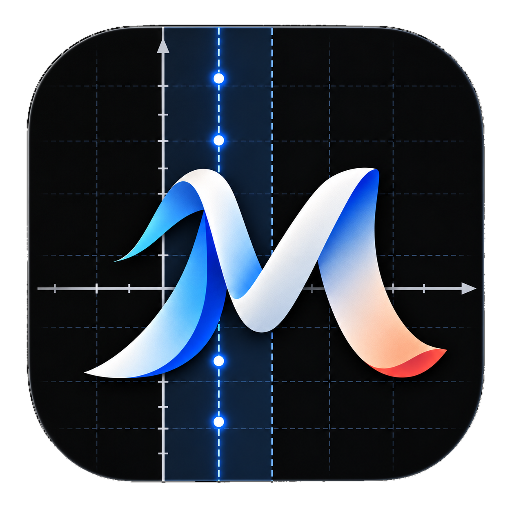

# Manim Studio



*Formerly MathEngine: the `mathengine` command and `.mathengine` projects still work.*

A drag-and-drop editor for [manim](https://www.manim.community/) (Community Edition) videos.
Build scenes visually on a Premiere-style timeline, edit any argument as Python, and export a real manim `.py`
file or MP4. The timeline and the code are the same thing: paste a manim scene and it becomes clips on the
timeline; edit the timeline and the code changes with it.

The GUI is generated by introspecting manim itself. Every `Mobject` and `Animation` class, with its
real constructor signature, appears in the library, including classes you define in the project's
header code. Nothing is reimplemented: previews are drawn by manim's own renderer, and exports run
the `manim` CLI.

## Download

Ready-to-run builds for Windows, macOS (Apple Silicon and Intel) and Linux are on the repository's **Releases**
page. Unzip and run the app; the `-cli` executable next to it renders from a terminal. The builds include
Python, manim and ffmpeg, but not LaTeX, which equations need (see below; everything else works without it).

- **Stable** releases (`v0.2.0`, …) are the ones to use. The app tells you when a newer one is out (it checks
  GitHub once per launch; turn it off in Settings, or set `MATHENGINE_NO_UPDATE_CHECK=1`). That choice, a dismissed
  update notice, the welcome card, the timeline's height and the Snap / Auto-intro / Auto-render switches are
  remembered in `prefs.json` in the app folder.
- **Nightly** is a single pre-release rebuilt from every push to `main`. It can be unfinished; nightly builds
  tell you when a newer nightly is out.

Releasing (`.github/workflows/release.yml`): set `version` in `pyproject.toml`, commit, then
`git tag v0.2.0 && git push origin v0.2.0`. The workflow runs the tests, packages the app on each platform
with PyInstaller (`packaging/manim-studio.spec`), checks that each package opens the editor and renders the
example project, and publishes the release. A tag that doesn't match `pyproject.toml` is refused. To build
one yourself:

```bash
pip install . pyinstaller              # on Linux also: pip install "pywebview[qt]"
cd packaging && pyinstaller manim-studio.spec   # -> packaging/dist/
```

## Install

```bash
uv venv --python 3.12 && uv pip install -e .     # or: pip install -e .
cd frontend && npm install && npm run build        # builds the UI into mathengine/web
```

Manim Studio needs manim 0.22 or newer: equations split into terms rely on how newer `MathTex` delimits its
parts. manim's system requirements also apply:
- **LaTeX** for equations (`MathTex`, `Tex`): MacTeX or BasicTeX on macOS, TeX Live on Linux, MiKTeX on
  Windows. It's found in its standard install locations even when it isn't on `PATH` (an app opened from the
  macOS Finder doesn't see `/Library/TeX/texbin` or Homebrew). Without it, numbers (measurements, value labels,
  axis numbers) and simple labels such as `A`, `\theta` or `x^2` are drawn with `Text` instead, so the rest of
  Manim Studio, including the starter constructions, keeps working; equations say they need LaTeX. After
  installing it, *Check again* in the scene panel picks it up without a restart.
- **ffmpeg** is bundled with manim via PyAV; no separate install is needed.

## Use

```bash
manim-studio                                # open the editor (native window via pywebview)
manim-studio examples/sine_tracker.manimstudio
manim-studio --browser                      # use your default browser instead
manim-studio render scene.manimstudio -q 1080p -o scene.mp4   # headless render
manim-studio code scene.manimstudio > scene.py # plain manim code
manim-studio scene.py                       # open a manim file: its scene becomes the timeline
manim-studio import scene.py -s MyScene -o scene.manimstudio   # the same, written to a project
```

- **Home** (at launch, and from the toolbar's Manim Studio button): *New project…* (name, format such as 1080p,
  4K, vertical or square, frame rate, background), *Open project…*, **Recent** projects with a preview, when they
  were opened, size and folder (filter, or remove one from the list), and **samples** to start from: *The
  derivative is a slope*, *Riemann sums*, *Altitudes of a triangle* and *Couple and uncouple*. A sample opens as
  an unsaved copy; select anything to see how it is built. Opening a project file directly skips Home.
  While a project has unsaved changes, a copy is kept every few seconds (in the app folder, under `recovery/`);
  if the app closes or crashes first, Home lists it under **Unsaved work** with *Restore* and *Discard*, and opening
  that project's file offers to restore the changes. Saving, or discarding the changes, removes the copy. Starting
  or opening another project over unsaved changes asks *Save*, *Don't save* or *Cancel*, and closing the app's
  window with unsaved changes asks whether to close anyway. Dropping a manim `.py` file on the window opens it (the native app opens
  project files too), and a dropped file never navigates the window away. A file that isn't a project (empty, damaged, or some
  other kind) is refused with a sentence saying so; launched with one, the editor starts at Home and says why.

- **Timeline** (bottom, the main workspace): the scene's `construct()` as a Premiere Pro–style timeline, in order,
  exactly as manim runs it: each step starts when the one before it ends.
  - Animations that play together (one `self.play`) share a **shaded column** and are stacked on tracks V1, V2…;
    the group lasts as long as its longest animation. Clips read object first (*circle · Create*). A **hatched
    block** across the tracks is a pause (`self.wait`). `AnimationGroup`, `LaggedStart` and `Succession` show their
    animations inside the clip, at the times manim plays them. Times are measured by running the scene with manim.
  - Steps that aren't animations (`self.add` / `self.remove`, code, couple / uncouple, scene calls, and anything
    disabled) sit in a slim **Other** strip under the ruler, shown only when the scene has some.
  - Click a group's shading to select it (Effect Controls show its animations and the settings it gives them all,
    such as `run_time`, which also appear in the corner of the shading). With it selected, drag any of its clips to
    move the whole group; drag the shading's right edge to retime it; right-click the shading for disable / delete.
  - Drag a clip into another group's column to play it with that group, or into a pause to start it there. The
    pause shrinks, and later steps move only when it doesn't fit, like an overwrite into a gap. Drag up or down to
    change its track, and Alt-drag to copy. While you drag, the timeline shows the result.
  - Drag a clip's right edge to change its `run_time` (a pause's edge changes its length); everything after it
    moves along. Values are rounded so the code stays readable.
  - Delete leaves the time as a pause (`self.wait`), like Premiere; Shift+Delete (ripple delete) closes the gap.
  - It snaps to the playhead, markers and clip edges (toggle with **S**). Shift-click or drag a box to select
    several clips, and right-click for more (enable/disable, ripple delete, show in code…). Ctrl/⌘ + wheel
    zooms, the scroll bar's ends zoom too, and `\` zooms to fit.
  - A clip that animates an object that isn't on screen yet (no Create, FadeIn or `self.add` before it) is
    marked with **!** and explained in Effect Controls: manim would show the object from that clip on.
- **Code** (the **</> Code** tab next to the program monitor): the scene as a manim file, both ways.
  - Edit the code and the timeline, canvas and inspector follow (as you type, after a short pause; turn off
    *Live* to apply with ⌘/Ctrl+Enter). Edit those and the code follows.
  - Clicking a line selects what it makes, and selecting a clip or object highlights its lines.
  - **Paste a whole manim file** (or *Open manim file…* on Home, or `manim-studio scene.py`) and its scene
    becomes the project. Each `self.play` becomes clips with their animations, `self.wait`, `self.add` and
    `self.remove` become statements, and `name = SomeMobject(...)` (with the method calls on it right after)
    becomes an object, created at the same point of `construct()` as in the file. Anything else (loops,
    updaters, helper variables, a `self.play` whose animations come from a list) is kept as a code step. So
    the scene runs exactly as written. Imports, helpers and custom Mobject classes stay at the top of the file,
    other methods of the scene class stay in it, and comments stay with their statements.
  - Code that is unchanged keeps what the editor knows about it: constructions, equation terms, disabled clips.
- **Library** (left): drag any manim class onto the canvas or straight onto a track. The *Effects* tab holds
  animations; dropping one on a track targets the selected object. Double-clicking a class adds it too, at the
  centre or the first free spot beside what is already there, so adding several doesn't pile them up. `/` jumps to
  the search box; type a name and press Enter to add the top result. Classes and the Scene outline can also be
  reached with Tab and used with Enter or Space, timeline clips with Tab and Enter (Shift+Enter adds to the
  selection, Delete removes), and every control has an accessible name (checked with axe-core).
- **Program monitor**: the frame at the playhead, rendered by manim. Select an object to move it, drag the
  corner handles to scale it, the edge handles to stretch it, or the top knob to rotate it. Arrow keys
  nudge it. With **● Record** on, each of these edits becomes an `.animate` clip at the playhead instead.
  Shift-click or drag a box on empty canvas to select several objects; right-click for actions.
- **Inspector** (right): *Properties* for objects (scrubbable Transform values, Style with color pickers
  and sliders, every constructor argument, and where `construct()` creates it), or *Effect Controls* for
  clips. Constructors can be methods of other objects, such as `axes.plot`. Effect Controls cover everything
  manim takes, each argument with a control from its signature:
  - **an animation**: its class, the object(s) it animates (a picker filtered to what the class accepts;
    chips for `FadeIn(*mobjects)`), its duration (`run_time`), every argument of its class including the ones
    every Animation has (`rate_func`, `lag_ratio`, `remover`, `introducer`, `suspend_mobject_updating`…), and
    its place in its `self.play` or group;
  - **`.animate`**: the methods it animates (each with its own signature) and the `.animate(...)` arguments
    (`rate_func`, `path_arc`, `path_func`…);
  - **`self.play`**: its animations (reorder, switch off, remove, add, group into `AnimationGroup`,
    `LaggedStart` or `Succession`), and the arguments it gives every animation plus its subcaption;
  - **compositions**: their animations (the same list), `lag_ratio` and the rest of their arguments, and Ungroup;
  - **`self.wait`**: `duration`, `stop_condition`, `frozen_frame`;
  - **any other scene method** as a statement (*+ self.…* on the timeline, or *Scene* in the library's Effects
    tab): `next_section`, `add_sound`, `add_subcaption`, `bring_to_front`, `add_foreground_mobjects`,
    `wait_until`, and the scene class's own, such as ThreeDScene's `set_camera_orientation`, `move_camera` and
    `begin_ambient_camera_rotation`; found by introspecting the scene's class;
  - **code**: a Python editor with highlighting; every statement also has its code comment.
- **Every parameter gets a control from its manim signature**:
  - numbers: drag the parameter name to scrub them; opacity values also get a slider;
  - colors: a picker;
  - points and directions: compass presets plus draggable x/y/z, or another object where manim allows one;
  - objects: an object picker, or toggle chips for several. These are filtered to the type manim needs: `Angle.line1` only offers lines, `get_area(graph)` only plotted functions;
  - enums, `Literal`s, `type[...]` choices (tip shapes, Graph vertex/edge types), scales (`LogBase()`), TeX templates and fonts: dropdowns;
  - ranges (`x_range`): min/max/step;
  - lists of numbers, colors, strings or points: list editors;
  - `t2c` / `tex_to_color_map`: substring → color rows;
  - `Matrix` / `Table` data: a cell grid;
  - Graph `vertices` and `edges`: chips, and dropdowns of the vertices;
  - config dicts: the target class's own fields (`axis_config` uses `NumberLine`'s parameters);
  - callables: working lambda templates;
  - file paths: a Browse button;
  - nested animations (`TransformAnimations`): a class plus target picker.
- **Only real options are shown**: inherited parameters that a subclass sets itself are hidden, such as Square's `height`/`width` or Brace's `path_obj`. So are those a class never forwards to its parent (like `Flash`'s).
- **Method chains**: each call is a card with its own signature. Pick from the object's chainable methods (those returning the object). This also covers the methods animated by `.animate` clips, such as `ValueTracker.set_value`.
- **Create from this object**: factory methods such as `axes.plot`, `axes.get_area` and `brace.get_tex` make a new object in one click, with required arguments pre-filled.
- **Raw Python**: every structured field has a `{}` toggle that shows the Python behind it. Anything manim accepts can be typed there (`BLUE`, `UP * 2`, `lambda x: x**2`, other object names).
- `scripts/verify_controls.py` runs the value every widget writes through manim, for every parameter of every class, animation and method. Rerun it after upgrading manim.
- **Code steps** run any manim code inside `construct()` (updaters, loops…).

### Visual construction

- **Drawing tools** (above the canvas, keys `1`–`7`): select, point, segment, arrow, circle, rectangle and
  polygon. A segment takes two clicks (its endpoints), a circle a center and a point on it, a rectangle two
  corners, and a polygon its vertices: click the first vertex again, double-click or press Enter to finish.
  The pointer snaps to points, crossings, endpoints, vertices, centers, midpoints, curves and the grid. For exact values,
  type them into the entry box next to the tools (`x, y`, a radius, or `width, height`) and press Enter.
- **Shapes stay editable through their defining parameters.** A drawn segment is `Line(start, end)`, a circle
  `Circle(radius)` at a position, a rectangle `Rectangle(width, height)`, and a polygon `Polygon(*vertices)`.
  Round handles edit endpoints, vertices, the radius and the corners, and the inspector's *Geometry* section
  takes exact numbers. The whole-object move, scale, stretch and rotate handles still work. For these shapes
  they are written back into the defining parameters, so the handles keep working afterwards.
- **Connected objects**: select objects and pick an action from the inspector or the right-click menu:
  - segments, arrows, midpoints and circles between points (center + point, or a diameter);
  - intersections of two lines, circles, graphs or axes (*Intersection*; a graph's *Mark roots* and *y-intercept*);
  - perpendicular and parallel lines through a point, altitudes (from a point to a line), feet of perpendiculars,
    drops from a point to the x- or y-axis, and perpendicular bisectors;
  - polygons through points;
  - arrows connecting two shapes' boundaries;
  - labels attached to any object or equation term;
  - points on a graph, circle or axes;
  - angle marks between two lines.

  A segment drawn from one existing point to another connects to both points, a point clicked onto a
  graph or circle is constrained to it, and a point clicked where two objects cross is their intersection.
  These chain: the altitudes of a triangle meet at an intersection (the orthocenter) that moves with the vertices.

  Lines count as extended both ways for intersections, perpendiculars and feet. When objects meet more than once,
  the inspector picks which crossing (ordered along a line from its start, left then right for two circles, by x on
  a graph); while they don't meet, the point stays where it was. Graph crossings are found numerically, and a jump
  at a discontinuity isn't counted as one.
  Connections refer to objects by stable id, so renaming is safe. They stay correct while you edit, during
  animations, when you scrub the timeline, and in the exported file.

  Dragging an attached label changes its offset. Dragging a constrained point changes its parameter: its `x`
  on the graph or its angle on the circle. If that value is a parameter, the drag sets the parameter's starting
  value; in **Record** mode it adds a `.set_value` clip instead.
- **Coupling existing objects**: select objects that already exist and pick from *Couple* (inspector or right-click):
  put a point on a circle, graph or axes, make it a midpoint, intersection or foot, attach any object to another,
  make a line connect two points, a circle go through them, or a polygon go through several. Each is built from where
  things are now, so nothing jumps further than the relationship requires. An independent object's inspector also
  has *couple to*.
- **Uncouple, couple again, forget**: *Uncouple* pauses a relationship without losing it: the object stays where it
  is and is edited and animated like any other. *Couple again* restores it; *Forget* removes it for good. Over time,
  *Uncouple* and *Couple* clips switch a relationship during the video (a Couple clip with a duration glides the
  object back into place); in the exported file these are `constraints.pause(…)`, `constraints.resume(…)` and
  `constraints.couple(…)`. The Scene tab's *Relationships* view lists every relationship with its state, sources,
  dependents and timeline switches.
- **Who owns what**: a connection owns either an object's *position* (labels, constrained points, midpoints,
  intersections, feet, measurements) or its *shape* (segments, perpendicular and parallel lines, circles, angle
  marks, graphs, tangents, areas, braces). Animations
  keep everything else: color, opacity, scale, rotation, and Create/FadeIn/Write. An animation that would move
  or reshape a connected object is flagged in its clip's Effect Controls, unless the object is uncoupled meanwhile.
- **Editing relationships**: the inspector's *Construction* section shows the sources (pickers limited to
  compatible objects), the expressions, the offset and the mode. **Detach** turns a connected object into an
  independent one at its current place or shape. Unticking *keep updated* freezes it: it is built once and
  then no longer updated.
- **Deleting** an object that others are built from asks whether to delete those too, or to detach them.
  Detached points, labels, segments, perpendicular and parallel lines, circles and polygons stay where they are; angle marks, areas, braces and
  tangents are always deleted, because they can't exist without their source.
- **Duplicating** several objects keeps the links among the copies; links to objects outside the selection
  keep pointing at the originals.
- **Problems are reported, not fatal**: missing sources, incompatible objects (an angle between points), objects
  defined in the wrong order, dependency cycles and undefined parameters each show on the object, and the rest
  of the scene still renders.
- **ƒ Graph** (toolbar) is an expression-first graph builder. Type `y = a*x^2 + b` and it:
  - offers each unknown letter as a named parameter slider, with a value, bounds and a step;
  - creates the axes and the graph in one step, with the domain and axis ranges exposed;
  - shows a live preview, rendered by manim, of exactly what will be added before you create it;
  - finds discontinuities (asymptotes, jumps) and leaves a gap around them so the curve isn't drawn across;
  - explains unsupported input in plain words: implicit equations (`x^2 + y^2 = 1`), inequalities,
    parametric or polar curves, and piecewise definitions.

  Parameters are ValueTrackers. Graphs, constrained points and number labels share them. A slider sets a
  parameter's starting value. To animate one, use *Animate to… → Add clip*, or drag a point bound to it on the
  canvas in Record mode; either adds `.animate.set_value(…)` at the playhead. The *Scene* inspector lists every
  parameter as a slider.
- **Annotations offered for each kind of object**:
  - segment: *Show length*;
  - two lines: *Mark angle*;
  - graph: *Point on curve*, *Tangent*, *Secant*, *Shade interval* and *Riemann rectangles*;
  - shaded area or Riemann rectangles: *Show integral (numerical)*;
  - tangent or secant: *Show slope*;
  - angle: *Show angle value*;
  - equation terms: *Brace*, *Label*, *Highlight* and *Color*.

  Interval bounds and the x of a tangent get handles on the axis. Shaded regions are visual only.
  Measurements are numbers computed in the scene, and the inspector says how: from manim, or numerically
  with the trapezoid rule.
- **Equations**: a `MathTex` gets structured math input (MathLive) and a LaTeX box. *Split into terms* makes
  each symbol one MathTex part, so `eq[i]` is that term. Repeated symbols are separate terms (`x #1`, `x #2`),
  so you choose the occurrence. Click terms in the inspector or on the canvas to color, brace, label or
  highlight them. Terms keep their identity when you edit the LaTeX, so their colors and pairings survive.
  *Check with manim* compiles the equation with real LaTeX and flags terms that render no glyphs.
- **Transform terms…** adds a `TransformTerms` clip. Its Effect Controls show the source and destination
  equations. Click a source term, then the term it becomes, or use *Pair identical terms*; unpaired terms fade.
  This only describes how terms move on screen. It does not check that the equations are equivalent.
- **Reusable constructions** (library *Build* tab): *Save as construction…* stores the selection, plus the
  objects it's built from and its clips, with the inputs you choose to expose: parameters, label texts, colors
  and visibility. Save it to this project or to your library (`~/.mathengine/constructions.json`, shared by all
  projects).
  - Inserting always creates new objects and names. An *independent copy* has no further tie to the template.
  - A *linked* instance can be regenerated with *Update instances* when the template changes, keeping its ids,
    names and inputs.
  - Starters: a labeled triangle, a unit circle, a number line, and a secant-to-tangent demonstration.
- **</> Code**: the whole scene as manim code, editable (see *Code* above).
- **▶ Smooth preview** renders a 480p30 video with manim (cached per animation). **Export video**
  renders at full quality; when it finishes, *Show in folder* and *Play* open the file manager at the video and
  play it with your default app.

In a window narrower than about 1480 px the toolbar's *Snap*, *Auto-intro*, *Record* and *Auto-render* switches
move into an **Options** menu, so Settings, Export video and Help stay in reach down to the 1000 px minimum.

**Help**: the toolbar's **? Help** button (or `?` / `F1`) opens a searchable guide to every feature, with
buttons that take you to the right place, and a guided tour that spotlights each part of the interface. First-time
users are offered the tour once.

Shortcuts: Space play · J/K/L · ←/→ frame (Shift ×5) · ↑/↓ edit points · Home/End · M marker ·
S snap · =/- zoom · Del / ⇧Del ripple delete · ⌘X/⌘C/⌘V clips · ⌘Z/⇧⌘Z · ⌘S save · ⌘N new project ·
⌘D duplicate object(s) · 1–7 drawing tools · Enter finish polygon · Esc cancel drawing, close a dialog, or go
back from Home · / search the library · ? or F1 help. (⌘ is Ctrl on Windows and Linux; other Ctrl, ⌘ and Alt
combinations are left to the system.)

## How it works

```
frontend/ (React)  ──HTTP (127.0.0.1 + session token)──▶  mathengine/server.py
                                                            ├─ catalog.py    introspects manim → palette & forms
                                                            ├─ codegen.py    document → manim Python (one statement per timeline step)
                                                            ├─ importer.py   manim Python → document (the reverse)
                                                            ├─ timeline.py   the timeline's statements
                                                            ├─ construct.py  linked objects, equation terms → manim code
                                                            ├─ mathexpr.py   math expressions (y = a*x^2 + b) → Python
                                                            ├─ starters.py   built-in reusable constructions
                                                            ├─ runtime.py    seek to time t in-process, render one frame
                                                            └─ render.py     `manim render` subprocess for video
```

A project (`.manimstudio`; `.mathengine` from earlier versions) is JSON: objects and the timeline, the list of
`construct()` statements (format 4). Every argument is stored as Python source, so anything manim accepts is
representable. Older projects are upgraded explicitly and losslessly (`project.upgrade`): format 3's clips at
times on tracks become the statements they compiled to. Optional fields:

- `link`: an object's relationship to others, by id;
- `eq.parts`: equation terms with stable ids;
- `param`: slider bounds of a ValueTracker;
- `instance`: membership of an inserted construction;
- `after`: the statement an object is created after (as in imported code; none: at the top of `construct()`);
- `comment`: comment lines above an object or statement;
- `scene.members`, `scene.members_after`: other code of the scene class (helpers, `setup`, class attributes);
- `timeline[].anims[].terms`: TransformTerms pairs;
- `constructions`: the project's templates.

Links store math expressions, not Python. Their dependencies are explicit: source ids, plus parameter names
that must be ValueTracker objects. Nothing is inferred from arbitrary Python. Each timeline step compiles to
exactly one statement (`self.play(...)`, `self.wait(...)`, `self.add(...)`, code), in order, with nothing added,
and objects are created where their `after` says (never before what they are built from). The importer
(`importer.py`) reads code back with Python's `ast` into the same statements, so code → project → code is
stable, and an imported scene runs exactly like the original (same length, same plays, same final picture;
`tests/test_importer.py`). Constructions compile to plain manim code too: a small `Constraints` helper, emitted into the file,
re-evaluates every construction in document order each frame and after each `self.play`. It skips any
mobject an animation is playing on (manim's `updating_suspended`). Segments become
`constraints.redraw(lambda: Line(A.get_center(), B.get_center()), A, B)`, attached labels
`constraints.follow(label, lambda m: m.move_to(A.get_center() + offset), A)`, and term-split equations
`MathTex(r"a^2", r"+", r"b^2", ...)` with `TransformTerms` for term correspondences. Seeking re-runs `construct()` with a `play()` that skips animations instead of
rendering them, stops partway through at the requested time, and draws that moment with the scene's
camera. This takes about 50 to 150 ms per frame, and the frame is exactly what the final render shows.

Development: `cd frontend && npm run dev` rebuilds the UI on change, and `manim-studio --serve --port 8765`
runs only the server. Tests: `uv pip install -e '.[dev]' && pytest`; they render real frames with manim,
and the LaTeX tests skip when LaTeX isn't installed. `scripts/ui_smoke.py` drives the editor in Chromium
(Playwright) through drawing, connecting, graphing, equations and constructions, checking the saved project
(it predates the statement timeline and its project-format checks need updating). `scripts/ui_workflow.py`
starts its own server per scenario and checks the everyday workflow: unsaved-work recovery, leaving a project,
shortcuts, remembered settings, the toolbar at every width, export, and (with `AXE_JS` set to axe-core's
`axe.min.js`) accessibility. Design notes on the visual construction tools are in
[`docs/research/math-object-creation.md`](docs/research/math-object-creation.md).
