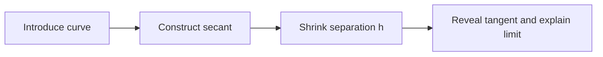

# Visual authoring models for Manim video making

**Researched:** 13 October 2026. **Scope:** Alternatives to the Premiere-style authoring workflow, targeting Manim Community. These are product recommendations informed by official documentation, not claims that the cited tools can import arbitrary Manim into an editable visual project. No application changes accompany this note.

## Recommended direction

Make a **storyboard of explanation beats**, with a **before/after canvas** inside each beat, the primary workspace. Give complex beats expandable animation-flow blocks. Add a relationships view for mathematical constructions and a script view for narration. These should be views of one scene document, sharing selection, undo, source references, and native rendering.

The existing timeline remains useful for reviewing precise timing and audio. It need not be the place where someone first creates an explanation. The question a beat answers is “What should the viewer understand next?”; the question a canvas answers is “What changes to show that?”

Manim already manages persistent mobjects, plays animations against them, and provides named sections. Its scene API gives a stronger foundation for these models than treating every operation as a piece of footage. [Scene API](https://docs.manim.community/en/stable/reference/manim.scene.scene.Scene.html)

| Visual model | User sees and edits | Best use | Recommendation |
|---|---|---|---|
| Storyboard / beat cards | Named moments, thumbnails, explanation, duration | Organizing an entire video | Primary navigation |
| Before/after canvas | Persistent objects in two states and the operation connecting them | Layout and motion authoring | Primary editing surface |
| Animation-flow blocks | Then, Together, Stagger, Repeat, Hold | Coordinating complex motion | Expand within a beat |
| Relationship graph | Parameters, objects, and explicit mathematical dependencies | Simulations and constructions | Dedicated supporting view |
| Equation workspace | Formula steps and term correspondence | Algebra and derivations | Dedicated supporting view |
| Narration cue sheet | Script phrases with attached actions | Synchronizing explanation and motion | Second major workflow |
| Reusable scene recipes | Preview, named inputs, style, contained beats | Making related videos efficiently | Library layer |

## 1. Storyboard and explanation beats

**Proposed experience:** Cards such as “Introduce the function,” “Move the sample point,” “Reveal the tangent,” and “Explain the derivative.” Each carries an actual frame thumbnail, short script, target objects, duration, and preview button. Open a card to edit its canvas and actions. Expand a chapter to see its beats rather than scanning dozens of horizontal lanes.

A beat can contain several `play` calls, waits, or setup statements. It should be a user-authored grouping, not a forced one-to-one alias for `self.play`. Reordering must check whether the destination has the required objects and parameters; dependent beats need a visible conflict or an explicit regrouping operation.

**Verified basis:** `next_section()` marks boundaries, and Manim can emit section videos and a JSON index with `--save_sections`. Sections alone do not make arbitrary sections independently runnable: preceding code may establish their state. [Output sections](https://docs.manim.community/en/stable/tutorials/output_and_config.html#sections)

**Inspiration:** Manim Slides places presentation boundaries with `next_slide()` and can loop rendered animation segments. It demonstrates that meaningful pause points can organize a Manim explanation without a media-editing interface. It is a presentation layer, not a general visual animation editor. [Manim Slides quickstart](https://manim-slides.eertmans.be/latest/quickstart.html)

## 2. Before/after canvas with explicit motion

**Proposed experience:** Select the starting state, duplicate it as the target, then drag the dot, scale the graph, change the title color, or enter a new parameter. Show a ghosted previous position and a compact change list. A transition chooser offers Move, Rotate, Follow path, Morph, Reveal, and Fade. Duration and easing belong to that operation.

Preserve object identity across states. Let a user distinguish “change this object” from “replace it with another,” and show objects that enter or leave. Offer a local progress scrubber and native preview, including intermediate frames. Endpoints cannot explain the whole motion.

**Verified basis and constraint:** `.animate` applies methods through interpolation between the original and resulting point sets. Manim explicitly warns this can behave unexpectedly for rotations and paths. Therefore a visual rotation handle should select an explicit `Rotate` operation when that is the intended motion; drawing a route should select `MoveAlongPath`. A final pose must not be treated as a complete motion specification. [Mobject.animate](https://docs.manim.community/en/stable/reference/manim.mobject.mobject.Mobject.html#manim.mobject.mobject.Mobject.animate), [Rotate](https://docs.manim.community/en/stable/reference/manim.animation.rotation.Rotate.html), [MoveAlongPath](https://docs.manim.community/en/stable/reference/manim.animation.movement.MoveAlongPath.html)

`Transform` normally mutates its source; replacing it with the target is a separate option. The canvas should expose this distinction because later actions may refer to different object identities. [Transform API](https://docs.manim.community/en/stable/reference/manim.animation.transform.Transform.html)

**Inspiration:** Rive visually connects animation states with transitions. Borrow the clear representation of states and transitions. A linear video needs a selected, deterministic traversal; interactive branching logic should be optional. [Rive state machines](https://rive.app/docs/editor/state-machine/state-machine)

Keynote's Magic Move offers an especially direct authoring precedent: duplicate a slide, rearrange its objects, and preview the transition. Figma Smart Animate similarly compares matching layers between frames, using their names and hierarchy. For our canvas, match stable object IDs instead; retain explicit Manim motion operations. Figma's documented limitations, including unsupported shape morphing, also illustrate why endpoint matching needs a defined capability boundary. These are interface inspirations, not proposed rendering backends. [Keynote Magic Move](https://support.apple.com/en-nz/guide/keynote/tanff5ae749e/mac), [Figma Smart Animate](https://help.figma.com/hc/en-us/articles/360039818874-Smart-animate-layers-between-frames)

## 3. Animation-flow blocks

**Proposed experience:** A vertical or nested block sequence reads:

```text
Introduce the function
  Together
    Draw axes
    Write equation
  Stagger
    Reveal sample points
  Then
    Move parameter x from -2 to 2
    Hold for explanation
```

The composition hierarchy communicates how the animation is organized. Selecting Together previews concurrent children; Stagger shows the offset relationship; Repeat presents one reusable body with an iteration count. Keep parent timing, child timing, and easing ownership visible when they differ.

**Verified basis:** `AnimationGroup` combines animations; its default `lag_ratio=0` starts them together. `Succession` plays animations successively, and `LaggedStart` offsets starts according to a lag ratio. A fixed group runtime rescales child scheduling, so the UI must display native effective timing rather than assuming “Together” means equal durations. [AnimationGroup](https://docs.manim.community/en/stable/reference/manim.animation.composition.AnimationGroup.html), [Succession](https://docs.manim.community/en/stable/reference/manim.animation.composition.Succession.html), [LaggedStart](https://docs.manim.community/en/stable/reference/manim.animation.composition.LaggedStart.html)

**Inspiration:** Motion Canvas exposes `all`, `chain`, `sequence`, and `loop` for animation flow. Its `sequence` uses a constant delay; Manim's lag ratio is relative to child duration. Borrow the vocabulary and readable composition, not an assumed equivalence between schedulers. [Motion Canvas animation flow](https://motioncanvas.io/docs/flow/)

## 4. Relationship graph and parameter laboratory

**Proposed experience:** Show `x → point on graph → tangent → slope label`, with the graph function and styling alongside it. Change `x` through a slider and watch all dependents respond. Record “sweep x” as an action in a beat. Select a relationship to inspect its formula, update policy, and dependent objects.

Keep this graph separate from the animation-flow view: “depends on x” and “starts after the title” are different relationships. Display editable declarative bindings; opaque Python updaters remain inspectable code. Known dependency cycles and multiple competing writers need explicit treatment rather than silently guessed ordering.

**Verified basis:** `ValueTracker` stores a real-valued parameter and can animate it continuously. Mobject updaters execute every frame; `always_redraw` regenerates an object from its factory each frame. These support connected constructions rather than independently keyframing every dependent visual. [ValueTracker](https://docs.manim.community/en/stable/reference/manim.mobject.value_tracker.ValueTracker.html), [Mobject updaters](https://docs.manim.community/en/stable/reference/manim.mobject.mobject.Mobject.html#manim.mobject.mobject.Mobject.add_updater), [always_redraw](https://docs.manim.community/en/stable/reference/manim.animation.updaters.mobject_update_utils.html#manim.animation.updaters.mobject_update_utils.always_redraw)

**Inspiration:** GeoGebra's Construction Protocol exposes construction steps and warns that dependencies can prevent reordering or cause cascading deletion. This is a useful pattern for explaining why a visual edit is constrained. [GeoGebra Construction Protocol](https://geogebra.github.io/docs/manual/en/Construction_Protocol/)

## 5. Equation workspace and mathematical actions

**Proposed experience:** Arrange formula states vertically. Select a term, connect it to the next formula's corresponding term, and choose Highlight, Copy, Cancel, Substitute, or Rearrange. Show correspondence arrows before previewing the transition. Preserve explicit term identities, especially when the same symbol appears more than once.

These actions should compile to supported animations and user-specified target formulas. “Cancel” can be a visual strike-through and removal action; it must not imply that the software proved the algebra correct. Adding symbolic validation is a distinct feature.

**Verified basis:** `TransformMatchingTex` matches submobjects by `tex_string`, not mathematical equivalence. Its base class supports a `key_map` and choices for unmatched pieces. Semantic term IDs can drive a richer UI, but their translation must account for native matching behavior rather than claiming text matching solves ambiguous repeated symbols. [TransformMatchingTex](https://docs.manim.community/en/stable/reference/manim.animation.transform_matching_parts.TransformMatchingTex.html), [Matching base API](https://docs.manim.community/en/stable/reference/manim.animation.transform_matching_parts.TransformMatchingAbstractBase.html)

## 6. Narration cue sheet

**Proposed experience:** Write the script as paragraphs and attach actions to selected phrases: “this point” highlights the point; “approaches zero” starts the parameter sweep. Each paragraph includes recording/import, playback, its beat preview, and cues. Retake audio without rebuilding the explanation. Keep sentence-relative anchors, while showing resolved timestamps for precise adjustments.

**Verified basis:** Manim Voiceover provides voiceover blocks, a tracker for audio duration, automatically reused subcaption text, and bookmark timing methods. It supports generated and recorded speech. These establish an implementation route for narration-driven actions. Word-aligned bookmarks need word-boundary data; imported recordings may require transcription or manual cue placement. Do not promise exact automatic phrase timing for every audio source. [Manim Voiceover quickstart](https://voiceover.manim.community/en/stable/quickstart.html), [Bookmark API](https://voiceover.manim.community/en/stable/api.html), [Word-boundary implementation](https://voiceover.manim.community/en/stable/_modules/manim_voiceover/tracker.html)

**Recommendation:** Make the cue format independent of any one speech service. Validate alignment when audio changes, distinguish start-on-word from finish-by-word, and show conflicts when an action needs more time than a phrase provides. Plugin integration still requires version and import/export compatibility checks.

## 7. Reusable scene recipes

**Proposed experience:** Choose “Derivative explanation,” preview it, fill in function, interval, colors, and narration, then edit its contained beats. Save a useful construction plus actions as a recipe with named inputs. Offer explicit linked versus independent instances and a reviewable update when a shared recipe changes.

This is a product layer over reusable Python scene construction and the project's existing templates, not a new Manim primitive. It makes the program a video-making framework by letting authors reuse explanation structure as well as geometry.

## Implementation boundaries

Start with storyboard navigation and native before/after previews, then supported target-state editing and flow blocks. Add narration cues and relationship navigation next; polish semantic actions and reusable recipes after the shared editing contract works.

Represent authored structure separately from runtime observations. Preserve imported Python, show native executed behavior, and allow visual edits only where there is a reliable mapping back to source. Loops, helpers, custom animations, and procedural updaters may be readable but partially editable. Preserve their code rather than approximating it into nodes.

Validate the first implementation on three complete examples: an equation derivation, a parameter-driven graph, and a narrated geometric construction. Check native render parity, legal beat reordering, persisted object identity, undo, and export/reimport behavior. Thumbnail quality alone cannot establish faithful execution.

## Applying this to our current program

Repository inspection on the research date found useful foundations already present:

- [Scene document types](../../frontend/src/types.ts) include stable object and equation-term IDs, explicit `Link` relationships, parameter bounds, templates, definitions, repeats, and anchored markers.
- [Actions](../../frontend/src/actions.ts) already offer contextual constructions and annotations, such as creating a tangent, attaching a label, or highlighting terms. Promote these into the primary creation flow.
- [Runtime](../../mathengine/runtime.py) reports object presence before/after steps, native animation curves, and selected object properties at animation boundaries. Its `ObjState` is a partial observation, not a complete serialized scene state.
- [Templates](../../mathengine/starters.py) already combine objects, actions, and exposed inputs. Extend their presentation into explanation recipes rather than introducing a second template system.
- [Statement model](../../mathengine/timeline.py) already supports nested compositions and Python compound blocks. A flow view can present that hierarchy directly.

**Recommendation:** start with a canvas-centered storyboard workspace. A navigator lists named beats; the center shows the selected beat's native frame; an action panel offers relevant mathematical and animation operations. A Start/Result switch and local progress control expose changes. An expandable flow view shows coordination inside the beat. Narration and Relationships are supporting workspaces, sharing the same selection and document.

Keep beats as named groups of existing source/step IDs, not copies of the whole scene or renamed video clips. Store layout and grouping as editor metadata; selecting another view must not rewrite imported code. A beat's duration is measured from its actions unless the user chooses an explicit duration or narration constraint. Native dependencies still govern which beat moves are valid.

This direction makes the framework's reusable unit an **explanation**: construction + parameters + actions + narrative cues + visual style. Generic Manim classes and Python remain available inside it. A universal node graph is better reserved for advanced inspection: one graph mixing object creation, mathematical dependencies, motion, narration, and camera control would be difficult to read. This is a design judgment, not a measured usability result.

### First prototype to validate

Use the existing derivative/secant examples to build four beat cards:



Create the construction on the canvas, save start/result parameter values, add “change h from 1 to 0.1,” choose duration/easing, and preview the native transition. Reveal an explicit tangent for the final state rather than dividing by zero at h=0. Add a script phrase to the shrinking action. A separate relationship view explains how changing h moves the second point and updates the secant and slope label.

The prototype succeeds if an author can complete that explanation with the timeline hidden, then export valid Manim, reopen it, preserve object identities and relationships, and change the function without rebuilding the lesson. Test a formula transformation and a motion-path example as well: they expose the limits of a purely before/after interface.

This note proposes the authoring framework; it does not implement these workspaces or assert that every imported Python program can be converted into editable beats.
