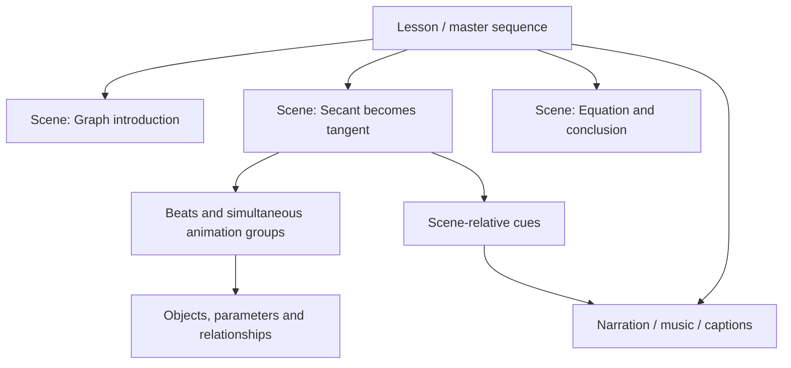
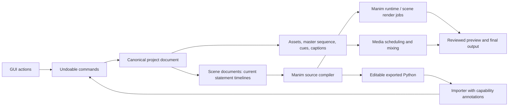
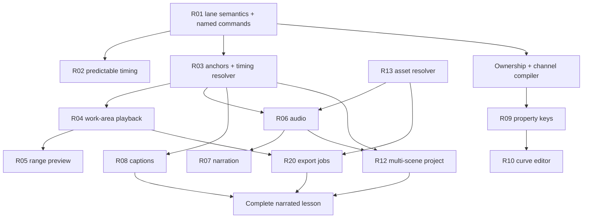

# Manim Studio: video editor workflow research and recommendations

**Research date:** 12 October 2026

**Branch reviewed:** `origin/worktree-ux-workflow`

**Exact revision:** `182798cd04c4b53ba6cded4443f340fbd8b7ce8d` — `Add and remove V tracks`

**Project:** [nikankad/ManimStudio](https://github.com/nikankad/ManimStudio)

**Purpose:** Recommend improvements to a GUI-first, code-second math animation engine, using Adobe Premiere Pro and other editors as workflow references.

This is a product and implementation research document. Existing behavior, researched editor behavior, and proposed behavior are identified separately. Recommendations and effort estimates are judgments, not measured user-study results. No application features were implemented for this report.

## Contents

1. [What I recommend first](#1-what-i-recommend-first)
2. [How the branch was reviewed](#2-how-the-branch-was-reviewed)
3. [What the branch already does](#3-what-the-branch-already-does)
4. [What to learn from professional editors](#4-what-to-learn-from-professional-editors)
5. [The workflow our app should support](#5-the-workflow-our-app-should-support)
6. [Prioritized feature recommendations](#6-prioritized-feature-recommendations)
7. [Architecture and document model](#7-architecture-and-document-model)
8. [Delivery roadmap and dependencies](#8-delivery-roadmap-and-dependencies)
9. [Validation and success measures](#9-validation-and-success-measures)
10. [Features to defer](#10-features-to-defer)
11. [Decisions to settle before implementation](#11-decisions-to-settle-before-implementation)
12. [Sources](#12-sources)

## 1. What I recommend first

The branch has become a capable visual scene editor. The next large improvement should be helping someone complete an entire narrated mathematical explanation in the app: plan it, animate it, adjust its timing to speech, review it, and export it.

The highest-value additions are:

1. **Make timing edits predictable.** Explain the result of a drag before release, distinguish simultaneous animation lanes from compositing layers, and attach markers and cues to the content they describe.
2. **Add an In/Out range and loop preview.** Let the user repeat a small section while refining a transform, rather than repeatedly playing the whole scene.
3. **Add narration as a first-class timeline workflow.** Import audio, show waveforms, trim speech, adjust volume, and synchronize animation beats to spoken phrases.
4. **Add editable property keyframes.** The existing diamonds navigate animation boundaries. Users also need to set and edit values at a time: position, opacity, rotation, and mathematical parameters.
5. **Add sequences and lesson structure.** A long video should be several editable scenes arranged in a master sequence, with narration and captions continuing across scene boundaries.
6. **Build reusable teaching workflows.** Improve the existing construction library with previews, exposed inputs, protected intro/outro timing, and an editable visual style system.

These additions should build on the branch's real strengths: Manim rendering, exact statement ordering, structured math objects, constraints, equation-term matching, and two-way code editing.

### 1.1 Recommended product direction

**A visual authoring and editing environment for mathematical explanations.**

Premiere is useful for organizing time and media. After Effects is useful for animating properties. Final Cut is useful for keeping related content together. Resolve is useful for separating tasks into coherent workspaces. Our app should combine selected ideas from those workflows around mathematical objects and relationships.

The editor should preserve the visual language the user requested: a black mathematical canvas, clear typography, deliberate colors, and motion that explains an idea. The editor's interface theme and the rendered video's style are separate settings.

### 1.2 A backend distinction that affects the plan

The reviewed branch uses **Manim Community Edition**, with `manim>=0.22,<0.23` in `pyproject.toml`, imports `manim`, and renders with the Community CLI. The original repository in this conversation, [`3b1b/manim`][MANIM-GL], is **ManimGL**, whose package and APIs differ. Its own README explicitly distinguishes the two projects.

Consequently, “3b1b-style output” is a valid design goal, but “supports everything in the original 3b1b engine” is not established by this branch. A second backend would need its own capability audit, runtime, importer, and parity checks. The workflow improvements in this report target the backend the branch actually uses.

## 2. How the branch was reviewed

### 2.1 Repository review

I fetched the requested branch and inspected it in a separate checkout at `/root/projects/ManimStudio-ux-review`. The local `main` and `/optimize` worktrees were not changed. This report uses the fetched revision above, rather than assuming an older local branch was current.

The comparison point was local `main`, `c06f64d`. The branch includes changes across 50 files, with substantial work in the timeline, inspector, project lifecycle, accessibility, preferences, rendering cache, and browser workflow checks.

Representative recent changes:

| Revision | Change | Why it matters |
|---|---|---|
| `182798c` | Add/remove empty V tracks | Users can adjust the visible lane count. |
| `b973421` | Remember each track's height | Dense and sparse timelines can use different heights. |
| `cad3eda` | Intro/outro ramps, effect curves, easing and keyframe navigation | Animation purpose and timing are more visible. |
| `128209d` | Replace the separate `self.play` bar with shaded group columns | Simultaneous clips are grouped visually; waits remain distinct. |
| `4bbfccb` | Dropped files no longer navigate away | Protects the editing session. |
| `d6edea1` | Unsaved-work recovery | Protects authoring effort after a crash. |
| `2bd8d43`, `745ec23` | Repair damaged render partials and bound cache size | Addresses repeatable failures and uncontrolled disk growth. |

### 2.2 Browser inspection

I launched the branch's shipped frontend and Python backend in an isolated local session, using a temporary app-data folder. At a **1500 × 950** viewport, I inspected Home, opened **The derivative is a slope**, sought to the end, and selected the first animation to inspect Effect Controls.

Observed:

- The derivative scene opened, displayed its final graph and tangent construction, and showed nine top-level steps.
- The timeline displayed an Other strip and V1–V3 lanes.
- Effect Controls showed the `Write` animation's target, measured duration, easing presets, and boundary diamonds.
- No JavaScript page errors were reported in this inspection.
- The library showed 144 classes in this environment; this is a runtime observation, not a hardcoded product limit.
- The welcome card was visible over the lower-right timeline area. This is a layout observation, not evidence that users cannot dismiss it.

Screenshots and an inspection record were saved under `/mnt/data/manim-studio-ux-review/`. This was a focused inspection, not a full usability study, complete regression run, or fresh export benchmark. Browser and native-window behavior can differ, particularly for file dialogs and playing exported files.

### 2.3 Research method

The external research uses official Adobe, Apple, Blackmagic Design, and Manim documentation. Premiere receives the most attention, with Final Cut Pro, DaVinci Resolve, and After Effects used for relevant comparisons. Pricing, subscription comparisons, and unsupported claims about feature parity are excluded.

The professional-editor workflow in Section 4 is my synthesis of those sources. The proposed Manim Studio behaviors are recommendations, even where a source inspired them.

## 3. What the branch already does

The following inventory prevents an existing feature from being mistakenly proposed as a new addition. Repository links point to the exact reviewed revision.

| Area | Verified implementation | Remaining opportunity | Evidence |
|---|---|---|---|
| Project lifecycle | New, open, save, samples, recent projects, dirty indication, leave confirmation, recovery | Named versions, collected assets, multi-scene projects | [Home][REPO-HOME], [store][REPO-STORE], [recovery][REPO-RECOVERY] |
| Timeline model | Ordered `construct()` statements; a play group begins after the preceding step | Explain legal placement and add richer scheduling without changing imported code | [types][REPO-TYPES], [timeline operations][REPO-TIMELINE] |
| Clip editing | Drag, Alt-copy, multi-selection, clipboard, right-edge duration edits, lift/delete, ripple delete | Explicit modes, fixed-total trims, supported animation splitting | [timeline UI][REPO-TIMELINE-UI], [timeline operations][REPO-TIMELINE] |
| Timeline display | Shaded play columns, nested compositions, pauses, Other strip, object-first labels | Persist logical lanes, filter by object/role, explain stacking versus rendering order | [timeline UI][REPO-TIMELINE-UI], [clip roles][REPO-ROLES] |
| Track controls | Add empty lanes, remove the last empty lane, individual remembered heights | Names, edit locks, targeted operations, audio tracks; output controls need defined semantics | [timeline UI][REPO-TIMELINE-UI] |
| Snapping and navigation | Playhead/marker/edge snapping, zoom, fit, timecode, frame and edit-point stepping | Work area, loop range, marker list, contextual shortcut routing | [timeline UI][REPO-TIMELINE-UI], [store][REPO-STORE], [panels][REPO-PANELS] |
| Markers | Add a point marker, jump to it, Alt-click to delete; optional label in the document type | Marker editing UI, ranges, categories, content-relative anchors | [types][REPO-TYPES], [timeline UI][REPO-TIMELINE-UI] |
| Easing | Presets plus Manim's full `rate_func` choices; curves/ramp display | Custom curve editor and clear ownership when a play group overrides easing | [inspector][REPO-INSPECTOR], [rates][REPO-RATES] |
| Keyframe-like navigation | Start/end diamonds for each animation affecting selected target(s) | Editable property values, interpolation, motion paths, channel lanes | [inspector: KeyframesRow][REPO-INSPECTOR] |
| Canvas authoring | Drawing tools, object transforms, exact entry, geometric handles, snapping | Alignment guides, screen-safe areas, semantic groups, camera tools | [viewport][REPO-VIEWPORT], [geometry][REPO-GEOMETRY] |
| Record mode | Canvas transformations and supported parameter drags become animation clips | Property-level animation affordances and clearer base-value/current-time editing | [store][REPO-STORE], [viewport][REPO-VIEWPORT] |
| Math construction | Graph builder, parameters, constraints, coupling, measurements, equation terms | Easier discoverability, dependency navigation, more guided math builders | [construction UI][REPO-CONSTRUCTION], [existing research][REPO-MATH-RESEARCH] |
| Reuse | Built-in, project and user construction libraries; independent or linked instances | Visual preview, search/tags, versioned updates, timing protection | [templates][REPO-TEMPLATES], [construction UI][REPO-CONSTRUCTION] |
| Library | Introspected classes, signature controls, search, drag/drop, double-click insertion | Search by intent, reusable motion presets, media bins | [library][REPO-LIBRARY], [catalog][REPO-CATALOG] |
| Code interoperability | Import scene code, preserve opaque code steps, regenerate code, retain unchanged metadata | Explicit GUI capability badges and clear conversion boundaries | [importer][REPO-IMPORTER], [codegen][REPO-CODEGEN] |
| Audio and subcaptions | Scene-method forms expose calls including `add_sound` and `add_subcaption`; play arguments include subcaptions | Dedicated waveform/audio/caption workflows; source calls are not media tracks | [README][REPO-README], [inspector][REPO-INSPECTOR] |
| Preview | Live Manim frames, reduced resolution during live playback, cached 480p30 preview, freshness checks | Range preview, priority scheduling, consistent clocks, better feedback | [store][REPO-STORE], [runtime][REPO-RUNTIME], [render][REPO-RENDER] |
| Export | Real Manim render subprocess, project quality or presets, progress, cancel, Show in folder, external Play | Persistent queue, render ranges, in-app review, caption sidecars, transparent output | [panels][REPO-PANELS], [render][REPO-RENDER], [server][REPO-SERVER] |
| Usability | Searchable help/tour, overflow Options menu, keyboard-accessible controls, remembered settings, reduced motion | Task workspaces, command search, shortcut editor, keyboard parity for all pointer actions | [help][REPO-HELP], [accessibility][REPO-A11Y], [workflow checks][REPO-UI-WORKFLOW] |
| Undo | Coalesced document snapshots, undo/redo, up to 200 prior snapshots in normal updates | Descriptive history, named checkpoints, selection/time restoration | [store][REPO-STORE] |

### 3.1 Three distinctions the interface should make clearer

**Animation lanes are not persistent video layers.** `Step.anims` is an array, and its position determines a row within that play. There is no persisted track entity or `trackId` in `SceneDoc`. Moving an animation up or down can reorder that array. V2 does not consistently mean a particular object's layer throughout the scene, and a lane number does not set Manim's `z_index`.

**Animation boundaries are not property keyframes.** `KeyframesRow` derives start/end times from measured animation spans. It does not store value/time/interpolation records for a property. Keep its useful navigation, but avoid suggesting that its diamonds can be dragged to change a value.

**Duration editing changes animation speed.** The right-edge handler writes `run_time`. It generally stretches the whole operation; it does not cut off part of already-rendered source footage. That distinction matters when adding a razor tool or two-sided trim handles.

### 3.2 Existing strengths to preserve

The statement timeline is a valuable contract: imported code can execute in its original order, and structured edits generate understandable Manim. Replacing that contract with an unrestricted media timeline would create a difficult migration and risk silently changing custom code.

The graph and relationship features are also a product advantage. A video editor sees pixels and media clips. Our app knows that a point belongs on a graph, an altitude depends on a vertex, and two repeated equation symbols are different terms. Recommendations should use that knowledge.

### 3.3 Engine coverage and GUI-first coverage are different measures

Introspection gives broad access to classes and parameters, but exposing a callable as a lambda template or a method as a signature form still requires programming knowledge for some tasks. The existing graph, geometry, equation, and construction builders demonstrate the better pattern: turn an authoring intention into structured, editable engine objects.

Track two measures independently: **engine API representability** and **completion of a task through visual controls**. A class appearing in the palette proves availability; it does not prove that a novice can produce a useful animation with it. This distinction should drive R18 and R23, and it prevents “every option is exposed” from becoming the GUI's completion criterion.

## 4. What to learn from professional editors

### 4.1 Premiere Pro: organize, assemble, refine, finish, deliver

The following is a synthesized workflow, rather than a claim that every editor follows these steps in a fixed order.

| Stage | Documented Premiere mechanism | Transfer to our app |
|---|---|---|
| Prepare sources | Source Monitor previews a clip and sets its usable range; Program Monitor previews the assembled sequence | Preview a construction or scene before inserting it. [Monitor documentation][AD-01] |
| Assemble timing | Separate ripple and rolling edit tools make different timing changes | Name the timing operation and show downstream impact. [Ripple][AD-02], [rolling][AD-03] |
| Select edit destinations | Source patching and track targeting distinguish placement from subsequent editing | Give track-targeted actions explicit scope. [Source patching][AD-04], [track targeting][AD-05] |
| Animate properties | Effect Controls can add property keyframes and display value/velocity graphs | Add real parameter/value editing at the playhead. [Keyframes][AD-06] |
| Structure dialogue | Transcript edits can rearrange time-linked footage | Connect narration phrases to visual beats. [Text-based editing][AD-07] |
| Reuse graphics | Templates are inserted and customized through exposed properties | Improve construction insertion and exposed inputs. [Graphics templates][AD-08] |
| Navigate meaning | Markers have properties and a management panel | Add a lesson outline and named cues. [Markers][AD-09] |
| Work responsively | Lightweight proxies support editing before full-quality delivery | Improve Manim-generated preview scheduling and quality choices. [Proxy workflow][AD-10] |
| Manage screen space | Workspaces can be saved, switched, and reset | Offer useful task layouts. [Workspaces][AD-11] |
| Mix narration | Ducking lowers music against speech using editable gain keyframes | Add readable audio controls before advanced mixing. [Audio ducking][AD-12] |
| Manage complexity | Nested sequences consolidate multiple edits into one linked clip | Add reusable scenes and master lesson sequences. [Nesting][AD-13] |
| Deliver and archive | Export presets, Media Encoder jobs, and Project Manager organize delivery | Add jobs, output presets, and collected project assets. [Export][AD-14], [queue][AD-15], [archive][AD-16] |

The useful lesson is that the editing action should reveal its effect on timing, sources, and output. A familiar arrangement of panels alone does not provide that workflow.

### 4.2 Final Cut Pro: keep related content together

Final Cut's primary storyline reacts to timing edits, while connected clips remain attached to their parent content. Its Position tool permits placement that preserves gaps. Roles organize content by purpose and support outputs such as audio stems. [Magnetic Timeline][APPLE-01], [roles][APPLE-02]

**Recommendation derived from this:** narration cues, highlights, captions, and comments should attach to an animation beat or scene when appropriate. A highlight that explains the tangent should move when the tangent demonstration moves. Music spanning an entire lesson may instead remain anchored to master-sequence time.

This does not require adopting Final Cut's complete timeline behavior. Our scene steps are already sequential. The useful addition is explicit connection and anchoring semantics.

### 4.3 DaVinci Resolve: separate tasks without losing context

Resolve provides distinct workspaces for editing, compositing, audio, and delivery. Its Edit page presents several placement operations, including insert, overwrite, replace, and fit-to-fill. Fairlight includes waveform editing, track mixing, automation, and voice-over recording. [Workspace overview][BM-01], [Edit page][BM-02], [Fairlight][BM-03]

**Recommendation derived from this:** use a small number of task layouts—Build, Animate, Narrate, Review/Export—with the same project and playhead. The Narrate layout should expose waveforms and cues; Build should expose math objects and relationships. Most users should not need every panel at once.

### 4.4 After Effects: property animation deserves its own tools

After Effects distinguishes interpolation of values over time from spatial motion, and its graph workflows let an author inspect and change speed. [Interpolation][AE-01], [speed graphs][AE-02]

**Recommendation derived from this:** prioritize a small, well-defined set of editable animation channels. Show whether a curve represents position, opacity, a ValueTracker value, or progress through an operation. A decorative easing line is useful, but it should not be mistaken for an editable property curve.

### 4.5 Editorial operations need different interpretations for math

| Editor operation | Appropriate Manim Studio interpretation | Important boundary |
|---|---|---|
| Insert | Add a new beat and shift subsequent scene timing | Respect object creation anchors and dependencies. |
| Overwrite | Replace an interval of a simple hold, preserving later timing where it fits | Do not silently overwrite arbitrary Python or part of a stateful animation. |
| Ripple duration edit | Change an operation's duration and move later beats | Explain that it changes speed, and resolve cue policies. |
| Rolling edit | Extend a supported animation while shrinking an adjacent hold | Keep combined duration fixed; stop at available hold duration. |
| Rate stretch | Change total duration of a supported beat/composition | Show original and resulting duration. |
| Razor/split | Split a supported value channel or rendered scene clip at the playhead | Generic Manim animations cannot safely be split by cloning them. |
| Slip | Change the source range of an imported audio or video clip | Many procedural animation operations have no source range. |
| Slide | Move a bounded master-sequence media clip while adjusting neighboring boundaries | Requires a master sequence or carefully defined neighboring holds. |
| Nest | Treat a scene or reusable segment as an editable unit | Do not equate an `AnimationGroup` with an isolated scene. |

The first two columns are proposed interpretations. Premiere's documented editing tools motivate the comparison, but their semantics cannot be transplanted unchanged. [Premiere tools][AD-17]

## 5. The workflow our app should support

### 5.1 Example: a narrated secant-to-tangent explanation

Target workflow, performed entirely through visible controls:

1. Create a 1080p lesson using an explanatory-math style preset.
2. Add three scene cards: Introduce the graph, Move the secant, Explain the limit.
3. Insert the existing secant-to-tangent construction and enter the function through math input.
4. Import or record narration. Its waveform appears below the visual beats.
5. Mark “two points,” “bring them closer,” and “the derivative” as named cues.
6. Drag the relevant parameter animation to the second cue and align the equation reveal to the third.
7. Set In and Out around the six-second demonstration and loop that range.
8. Add a parameter keyframe at the start and another at the end; choose easing by the desired movement.
9. Pair equation terms using the existing visual transform editor.
10. Preview with narration, make one timing adjustment, and see which cues will move before committing it.
11. Review captions and the small-screen preview, fix any clipping, and save a named checkpoint.
12. Export the full lesson, its captions, and an optional short excerpt from the selected range.

Code remains available for advanced customization. Nothing in this target workflow requires opening it.

### 5.2 The three editing levels



This is a proposed product hierarchy. The branch currently implements the scene and object/animation levels, with one scene document at a time.

## 6. Prioritized feature recommendations

### 6.1 How to read the backlog

**P0:** removes a fundamental source of confusion or establishes a dependency needed by high-value workflows. **P1:** substantial authoring benefit once those foundations exist. **P2:** useful after the core workflow is reliable.

Effort is relative: **S** is a focused UI/local change, **M** spans several modules, **L** adds persistent behavior and runtime/export work, and **XL** changes the project model or renderer scheduling. These are planning estimates; they are not delivery-date promises. A P0 item can still be large and need several releases.

| ID | Recommendation | Priority | Effort | Main dependency |
|---|---|---|---|---|
| R01 | Clarify lanes, layers, and animation groups | P0 | S initially; L for persistent lanes | Product semantics |
| R02 | Explicit timing modes and edit-impact preview | P0 | M–L | R01 |
| R03 | Anchored markers and cues | P0 | M–L | Shared timing resolver |
| R04 | In/Out, loop range, preview/render selection | P0 | M–L | Range policy; R03 for anchors |
| R05 | Responsive, trustworthy preview pipeline | P0 | L | Revision-aware job scheduling |
| R06 | Audio tracks, waveforms, trims, gain | P0 | L | Asset references, R03 |
| R07 | Narration cues, script panel, recording | P1 | L | R06; recording later |
| R08 | Caption lane and sidecar export | P1 | M–L | R03; transcript import optional |
| R09 | Editable property keyframes | P1 | XL | Property ownership and time model |
| R10 | Curve editor and motion-path controls | P1 | L | R09 |
| R11 | Semantic grouping and coordinated selection | P1 | M | Stable object/animation IDs |
| R12 | Multi-scene lessons and nested sequences | P1 | XL | Project wrapper, R03, R06 |
| R13 | Project asset browser and portable packaging | P0 for basic assets; P1 for packaging | M–L | Asset resolver |
| R14 | Better construction and motion templates | P1 | M–L | Existing template model |
| R15 | Visual style tokens and layout guides | P1 | M | Style schema; property ownership |
| R16 | Visual camera framing and camera beats | P1 | L | Scene-base capabilities |
| R17 | Dependency navigation and actionable diagnostics | P1 | M | Existing relationship/diagnostic data |
| R18 | Guided tasks and intent-based discovery | P0 | M | Command registry; existing help |
| R19 | Task workspaces and contextual shortcuts | P1 | M | UI layout and command state |
| R20 | Export queue, output presets, in-app review | P1 | L | Immutable job snapshots; R04 |
| R21 | Descriptive history and review checkpoints | P1 | M–L | Revision IDs; R03 |
| R22 | Explicit GUI/code boundaries and editor handoff | P1 | M initially; L for media handoff | Importer metadata; R20 |
| R23 | More guided mathematical authoring workflows | P1 | L, delivered by family | Catalog and math expression support |
| R24 | Parameter variants and batch outputs | P2 | M–L | R14, R20 |

### R01. Make animation lanes, layers, and groups understandable

**Current state:** V rows are positions in each play's animation list. Empty-row count and heights are preferences. There is no persistent track identity. Manim drawing order is controlled separately.

**Problem:** A user familiar with Premiere may assume that a clip on V3 is a lasting video layer above V2. Moving it vertically may instead reorder an animation argument, including inside a composition where order affects timing.

**Recommended first version:**

- Label the scene view's rows **Animation lanes**, with a brief explanation available beside the label.
- Call shaded columns **Play together** in ordinary workflows; expose `self.play` in the advanced view and code.
- Show the selected object's rendering order in a separate Layers/Scene view.
- Distinguish semantic roles such as Diagram, Equation, Labels, and Camera from intro/outro/effect classifications.
- Keep the existing ramps, measured curves, group shading, and resizing.

**Later version:** Persist lane IDs and names as organization metadata. Moving a clip between display lanes should not silently change its start time, composition order, or rendering depth. Provide a separate command for changing composition order.

**Acceptance:** Moving a clip to a display lane preserves the measured output; an explicit “reorder in group” action visibly changes order. Users can explain whether “above” refers to a lane or a drawing layer. Edit locks prevent accidental authoring changes without deleting code.

**Implementation:** Start in `Timeline.tsx` and `Inspector.tsx`; later extend `types.ts` and project migration. Do not implement track-output mute until its effect on an object's later state has been defined.

### R02. Add explicit timing modes and show edit consequences

**Current state:** Placement automatically joins an existing play or splits a plain wait; duration edits update `run_time`; delete and ripple delete already exist.

**Recommended GUI:** A compact editing toolbar with Select, Insert beat, Play together, and Duration. Provide **Keep later timing** when an adjacent simple hold can absorb the duration change. During drag, show an outline of the resulting placement and plain feedback such as “Starts with Graph reveal at 4.0 s” or “Later beats move by +0.8 s.”

**Example:** Extending a parameter animation from 2.0 to 2.5 seconds can either push later content by 0.5 seconds or consume 0.5 seconds of the following hold. The user chooses deliberately.

**Rules:**

- Joining a play uses the play's start, not the pointer's arbitrary position within it; show that landing time.
- Do not offer overwrite for arbitrary code steps or stateful animations.
- A shared `self.play(run_time=...)` override must be visible when editing an individual clip.
- Show which markers, audio, and captions are anchored and will follow.
- Escape cancels; one committed gesture produces one undo item.

**Acceptance:** A duration edit that preserves total timing leaves the next beat's measured start within one project frame, provided sufficient adjacent hold exists. An impossible fixed-timing edit explains the limitation without partially changing the document.

**Implementation:** Add edit-intent commands above `landing`, `placeSteps`, `setAnimDuration`, and `setStepDuration`. Return an impact summary before committing. Preserve current behavior for imported scenes. Premiere's ripple/rolling distinction is the workflow reference. [Ripple][AD-02], [rolling][AD-03]

### R03. Upgrade point markers into anchored cues

**Current state:** Markers store an absolute `time`; the UI adds, seeks, and deletes them. A label is representable but there is no substantial marker editor.

**Recommended GUI:** Double-click a marker to edit its name, notes, category, optional range, and anchor. Add a searchable Cue list with Chapter, Narration, Visual event, and Review filters.

**Anchors:** Absolute sequence time; scene start plus offset; step/animation start or end plus offset; audio-source cue attached to a particular audio clip. The last case follows audio trimming and placement, rather than just visual ripple changes.

**Example:** “Say derivative” can stay attached to the relevant source word in narration. “Reveal derivative equation” can stay attached to an animation's start. A link between the two can report drift without conflating their identities.

**Deletion and retiming:** Deleting an anchor offers reassignment, conversion to an absolute position, or deletion. Retiming a clip uses a declared policy for interior cues: preserve source progress, preserve offset, or flag for review. Never leave a dangling reference silently.

**Acceptance:** A cue attached to a moved animation follows it through move, copy, undo, save/reopen, and supported code round trips. Duplicating a scene creates correctly remapped cue IDs. Legacy point markers remain at their saved absolute time.

**Implementation:** Extend `Marker` rather than discard it. Use one timing resolver shared by the timeline, snapping, preview, caption and audio scheduling, and export. Content connection is inspired by Final Cut; marker management is inspired by Premiere. [Connected clips][APPLE-01], [markers][AD-09]

### R04. Add In/Out ranges, loop playback, and render selection

**Current state:** The transport plays the scene and steps through frames/edit points. There is no persisted work area or loop range in `AppState`/`SceneDoc`.

**Recommended GUI:** Set In, Set Out, Clear range, Loop, Play range, and Render range beside the transport. Drag range handles above the timeline. Provide buttons as well as I/O shortcuts. Keep a visible range-duration readout.

**Default:** Playback and export remain whole-scene unless the range is explicitly selected. An unfinished range has a clear behavior, such as In-to-end; it should not invisibly alter export.

**Rendering requirement:** Starting at 8 seconds requires executing the preceding scene state correctly. Earlier animations, object construction, updaters, and code must establish the start frame. A range is not permission to skip execution before its In point. A first implementation may render the full scene and trim the output; that is correct but does not deliver faster rendering, so describe it accurately.

**Acceptance:** The range's first and final included frames match the full export at those times. Looping repeats the same selected interval and keeps audio aligned. Empty or reversed ranges explain the issue. Export states whether Out is exclusive and shows the resulting frame count.

**Implementation:** Separate editor work-area state from document content. Add explicit time-range parameters to preview/render jobs, and later optimize supported pre-roll cases. The monitor In/Out workflow is the reference. [Monitors][AD-01], [export preview][AD-14]

### R05. Make preview responsiveness and freshness visible

**Current state:** Frame requests are serialized; pending requests collapse to newer state. Timeline analysis is debounced. Full-scene smooth previews use document fingerprints and Manim's partial cache. The branch already repairs damaged partials and prunes cache files.

**Recommended GUI:** Display Preview ready, Updating this frame, Rendering selected range, or Preview out of date. Offer Auto, Draft, Half, and Full display quality with a separate project/export quality. Give a failed preview a visible Retry action.

**Pipeline changes:**

- Prioritize the latest requested paused/scrub frame over background work.
- Tag frame requests, timeline analysis, and rendered videos with document revision and requested time.
- Drop responses from an older project/revision; use a deliberate playback policy for intermediate frames of the current revision.
- Render the active work area before the full scene.
- Reuse unaffected render segments, while invalidating dependent later state conservatively.
- Treat fonts, image/audio contents, engine settings, and supported external dependencies as inputs to cache freshness.

**Clock issue to validate:** Smooth preview is currently configured as 480p30, while project frame rates include 24, 60, and 120. Frame-quantized timing and `dt` updaters may differ at another rate. Measure this before changing policy; this inspection did not establish a specific mismatch. Prefer the project simulation rate with lower pixel resolution when exact timing is required.

**Acceptance:** A late response never replaces a newly opened project's frame. Cached and regenerated results match for supported cases. A changed asset invalidates its affected previews. Loop playback uses an audio/video clock that does not drift during a long narration.

**Implementation:** `store.ts`, `server.py`, `runtime.py`, and `render.py`; use scheduling and revision metadata before attempting state snapshots of arbitrary Python. Proxies inspire the quality separation, but procedural previews require regeneration. [Premiere proxies][AD-10]

### R06. Add real audio tracks and waveform editing

**Current state:** `add_sound` is accessible as a scene call. This exposes an engine API, but it does not supply editable audio clips, source In/Out, waveform lanes, or a mixer.

**Recommended first GUI:** Import audio into Project assets, drop it onto Narration or Music, inspect its waveform, move it, drag trim edges, split it, change gain, add fades, mute/solo for monitoring, and choose whether it follows a scene or stays at master time.

**Data:** Audio source ID, source range, placement anchor, clip duration, gain, fade envelope, role, and explicit export-enabled state. Keep sample-accurate source ranges separate from the display's video-frame snapping.

**Example:** A 45-second narration remains on A1 while several visual scenes change underneath it. The author can see speech pauses and use them for holds without writing `self.add_sound(...)`.

**Export path:** For simple placement, generated Manim sound calls may be sufficient. Source trimming, envelope automation, cross-scene audio, and mixing need a media preparation/mixing layer. Emit prepared audio plus clearly documented references, or package a standalone export runner. Raw Manim `add_sound` is not a substitute for those operations. [Manim Scene API][MANIM-SCENE]

**Acceptance:** Imported WAV and supported compressed audio show the correct duration and waveform; trim and split are nondestructive; mute/solo monitoring cannot silently alter the exported mix. A cue transient aligns to its intended visual event within one output frame. Missing media can be relinked.

**Implementation:** Introduce asset IDs/resolution with R13 first; then audio clip schema, waveform analysis, preview synchronization, and final mixing. Use a single decoded source clock to avoid adding conversion error at every split.

### R07. Add a narration/script panel tied to visual beats

**Recommended GUI:** A Script tab with paragraphs or phrases, each linkable to a scene, range, or audio cue. Click text to seek. Assign a selected phrase to “Reveal equation,” “Move point,” or another existing beat through a picker. Show unassigned phrases and visual beats without narration.

**First version:** Manually typed script plus imported audio and manual cue placement. Next, import transcripts with timestamps and let users correct them. Recording should add microphone selection, a countdown, monitoring, stop/review, and alternate takes; device and native/browser support must be validated.

**Important rule:** Editing script text does not automatically trim audio unless the user enters an explicit transcript-edit mode. Typed text and an already-recorded sentence can differ. A regenerated transcript should not replace manual mathematical terminology corrections without review.

**Acceptance:** A teacher can attach three phrases to three beats and retime visuals to cues through controls. Reordering a script paragraph shows its proposed timing impact before moving content. Recording a new take leaves the prior take available.

**Implementation:** Stable phrase/cue IDs attached to audio clips, then commands that adjust supported waits and animation durations. Automatic speech recognition is optional and comes after manual synchronization works. Premiere's transcript workflow and Fairlight recording are the references, not a promise of identical automation. [Text-based editing][AD-07], [recording][BM-03]

### R08. Add a dedicated caption lane and sidecar export

**Current state:** Manim subcaption calls and play subcaption arguments are exposed. The Export panel manages an MP4 path and does not offer a complete caption-track delivery workflow.

**Recommended GUI:** A Caption lane and text list; edit wording and timing, split/merge segments, import/export SRT and WebVTT, choose language, and preview optional burned-in captions. Keep explanatory equation labels separate from spoken captions.

**Math-specific controls:** Allow a spoken version of a formula, such as “delta x,” alongside its on-screen `Δx`. Preserve technical spelling during transcript corrections. Warn about overlaps, clipped text, and dense segments, with a user-adjustable reading-rate target rather than a universal hard rule.

**Export:** Separate choices for sidecar captions and burned-in captions. Explain that a sidecar alone does not embed text in the MP4. Use a declared plain-text serialization for formulas in SRT/WebVTT. [Premiere captions][AD-18]

**Acceptance:** Sidecar timings match exported frames after a ripple edit. Burning captions changes the reviewed render exactly as shown. Imported caption punctuation and math labels survive save/reopen. A duration-zero scene does not create a misleading caption export.

**Implementation:** Map existing supported subcaption calls to editable caption records when unambiguous; preserve opaque calls unchanged. For scene-only code export, generate `add_subcaption` where appropriate. Package sidecars alongside video instead of leaving them hidden in the render cache.

### R09. Add editable property keyframes, starting with parameters

**Current state:** Record mode writes `.animate` clips. The Keyframes strip navigates existing animation starts and ends. Object properties are largely constructor values and method chains stored as Python source.

**Recommended first GUI:** For a `ValueTracker` parameter, place an Animate toggle and Add keyframe diamond beside the value. Set the playhead, set the value, and add a key. Expand a channel lane beneath the selected object's animation lane to move keys and inspect their numeric values.

**Then support:** Position, opacity, rotation, and scale for independent objects whose state is representable. Each property needs a clear coordinate/reference space. Absolute scale requires a defined baseline; it cannot be implemented by repeatedly applying `.scale(value)`.

**Editing rules:**

- **Edit initial value** changes the starting scene state. **Edit at current time** adds or changes a key. The interface must expose this choice.
- Display values evaluated at the playhead, not just constructor values, in the animated-property view.
- A key has an ID, property/channel, time anchor, value, and interpolation to the next key.
- A property owned by a relationship shows that owner. Animate its driving parameter, or explicitly uncouple before taking over the property.
- If another animation writes the same property at that time, report the conflict; do not apply last-writer-wins silently.
- Keep original complex animations intact rather than converting everything into sampled keyframes.

**Example:** Select the graph's `x0` parameter, add a key at 0.5 seconds with value −2, another at 4 seconds with value 2, and adjust the second key through its numeric editor. The point, tangent, and slope measurement follow the parameter through their existing relationships.

**Acceptance:** Seek, live preview, smooth preview, and final export agree at keys and intermediate frames. Adding one key does not change unrelated object properties. Undo restores the channel and selection. Unsupported custom state remains accessible through code with a clear explanation.

**Implementation:** A small channel compiler first for ValueTrackers, then additional channels. Use Manim-native interpolation/animations or emitted helpers with explicit evaluation rules. A channel crossing a stateful code step must not be compiled by splitting and restarting that step. Property-keyframe interaction is informed by Premiere. [Keyframe controls][AD-06]

### R10. Add curve editing and motion-path handles

**Current state:** Easing presets and sampled progress curves are present. Those samples describe operation progress, not necessarily an object's physical value or speed.

**Recommended GUI:** Expand Easing into a curve view with presets, draggable control handles, numeric control points, and a test-play button. For supported position channels, show the motion path on the canvas with endpoint and tangent handles. Allow editing time easing separately from spatial path shape.

**First version:** Linear, smooth/ease presets, and a monotonic cubic Bézier time curve. Its horizontal axis is normalized time and vertical axis is normalized progress. Later add property-value graphs and speed graphs with units.

**Semantics:** A cubic Bézier easing function needs inversion of its x coordinate; directly evaluating Bézier y at `t` is not generally equivalent. Give generated helpers a deterministic implementation shared between preview and exported code. Allow existing nonmonotonic functions such as There and back without labeling them as monotonic curves.

**Acceptance:** The curve produces the same progress in preview and export at sampled times. Negative/overshooting progress, where supported, is displayed honestly. Unsupported spatial paths are preserved as custom paths instead of being approximated silently.

**Implementation:** Extend the existing `rates.ts` display and add a compiler-side curve representation. Keep measured Manim curves as read-only evidence when the source function is opaque. After Effects supplies the reference distinction between temporal changes and spatial motion. [Interpolation][AE-01], [speed][AE-02]

### R11. Add semantic groups and coordinated selection

**Current state:** Multi-selection, group animation compositions, and reusable constructions exist. These are different from grouping a diagram's objects for organization and coordinated transforms.

**Recommended GUI:** Select a triangle, its vertices, labels, and angle mark; choose **Group diagram**. Give it a name, collapse it in the outline, and move it as a unit. Select a timeline clip to highlight its object; select an object to show all of its relevant clips. Add a Timeline filter for Selected object and Related objects.

**Rules:** Organizational folders, transform groups, and `AnimationGroup` compositions should be different concepts with distinct controls. A transform group needs a pivot and relationship-aware transformation of its sources. Do not transform dependent labels twice by moving both them and their owning construction.

**Acceptance:** Moving a grouped construction preserves its geometric relationships. Ungroup preserves appearance. Duplicating the group remaps internal links and retains deliberate external links. Filtering changes the view, not the generated scene.

**Implementation:** Start with outline folders and cross-selection, then add transform-group metadata using stable object IDs. Implement a global multi-object transform command that understands property ownership.

### R12. Add multi-scene projects and a master lesson sequence

**Current state:** `SceneDoc` has one `scene`, one object list, and one statement timeline. The importer can identify scenes in source, but that does not make the current document a multi-scene video project.

**Recommended GUI:** A Scenes panel with cards, thumbnails, names, durations, and status. Double-click a card to open its current scene editor. A Master timeline arranges scene instances plus narration, music, and captions. A breadcrumb and shared time mapping explain where the local playhead sits in the lesson.

**Initial scope:** Sequential scene instances and optional holds/cuts. Reorder, duplicate, disable, and open the source scene. Keep the generated animation for each scene editable. Implement transitions after cut-based assembly is stable.

**Later scope:** Nested sequences, reusable scene instances, variations, crossfades, and trimming rendered source ranges. Updating a source scene must show the consequence for instances whose selected range now exceeds its duration. Premiere's nesting model is a useful reference. [Nested sequences][AD-13]

**Acceptance:** A three-scene lesson exports in master order with continuous audio. Reordering scenes updates anchored captions and cues. Editing a source scene invalidates the affected instances, not unrelated scenes. A nested sequence cannot contain itself through a reference cycle.

**Implementation:** Introduce a project wrapper around existing version-4 scene documents; migrate old files into one scene plus one master instance. Render scenes independently, then compose/mix the master with a media pipeline. Validate frame sizes, rates, duration rounding, and audio tails before joining outputs. Do not concatenate encoded files blindly when their formats differ.

### R13. Add a project asset browser and portable packaging

**Current state:** Path controls can browse files used by Manim objects and scene calls. The project model has no central asset manifest or media bins.

**Recommended GUI:** Project assets beside the existing Objects/Effects/Build tabs. Import images, SVGs, audio, and supported data files; show thumbnails/waveforms, name, type, duration/dimensions, used-by, and missing status. Dragging an asset should create the appropriate object or audio clip through visible controls.

**First delivery:** Asset IDs, relative path resolution against the saved project, metadata, duplicate detection, and relink. Video import can follow after the master sequence exists; an arbitrary MP4 should not be treated as a native Manim Mobject.

**Packaging:** **Collect project…** copies selected dependencies and the project to a new folder, rewrites resolvable paths, lists external fonts/TeX/tool requirements, and optionally includes preview/output files. Preserve the original project and source files. Premiere's Project Manager provides the archival reference. [Project collection][AD-16]

**Limit:** Arbitrary Python may open dynamic paths or network resources. The app cannot promise to discover those automatically. Show unresolved/custom dependencies and allow the author to add them explicitly.

**Acceptance:** Move a collected project to another folder or computer and relink only genuinely external requirements. Assets sharing a filename are not confused. An asset renamed through the app updates references by ID, including template instances.

**Implementation:** An asset resolver used by preview, generated code, render jobs, and packaging. Do not use process working directory as an implicit project asset base. This is the foundation for audio, captions, and reliable asset-aware caching.

### R14. Improve construction templates and add reusable motion presets

**Current state:** Construction templates already contain objects, timeline steps, and exposed parameter/text/color/visibility inputs; linked updates preserve instance information.

**Recommended GUI:** Template cards with a preview, searchable topic/tags, duration, required dependencies, and an **Insert** dialog that updates its preview as inputs change. Add a motion-preset library separate from the object-construction library: Reveal equation, Emphasize term, Compare side by side, Sweep parameter, and Hold then fade.

**Timing controls:** Expose Intro, Main demonstration, and Outro spans where the template author defines them. **Fit to selected range** can stretch the main section while protecting its authored introduction and exit. This is a proposed template feature; existing templates do not currently store those timing regions.

**Linked updates:** Show a diff of inputs, objects, and beats before updating. Include Keep overrides, Reset input, Update this instance, and Update selected instances. Version templates so a saved lesson does not change merely because the user's library changed.

**Acceptance:** Insertion previews match the inserted scene. Changing a linked template does not erase instance-specific narration cues or unrelated styling. Independent copies remain independent. A saved template declares whether it needs LaTeX or custom code.

**Implementation:** Extend existing `Template` metadata; keep local IDs and remapping. Use immutable version references for reliable updates. Premiere's exposed template properties are the workflow reference. [Graphics templates][AD-08]

### R15. Add an explanatory-math style system and layout guides

**Current state:** The default project canvas is black; samples already use a suitable mathematical visual language. Style is primarily edited per object through constructor arguments and method chains.

**Recommended GUI:** A Style panel with editable tokens for Background, Primary quantity, Secondary quantity, Emphasis, Equation text, Label text, Axis, and Construction line. Include typography and stroke defaults. Offer an **Explanatory math** preset reflecting the requested output direction without implying an official 3Blue1Brown package or exact reproduction of every video.

**Rules:** Theme changes affect linked style tokens, not arbitrary explicit user colors. Keep per-object overrides and show them. Assign repeated mathematical quantities consistent colors across scenes. Editor light/dark appearance stays independent of these video settings.

**Layout additions:** Align/distribute controls, draggable guides, safe-area overlays, a small-screen preview, and optional caption reserve area. Add a visual warning when labels clip outside the camera or overlap an equation, with a dismissible per-item decision.

**Acceptance:** A project's style is saved and exported reproducibly; changing a token updates its intended users and preserves overrides. Canvas guides do not render into the final video. A vertical export preview shows actual crop/reframing consequences before export.

**Implementation:** Store tokens plus object references to them; resolve to ordinary Manim values during code generation. Keep text size/stroke defaults predictable rather than changing geometry based on editor zoom.

### R16. Add camera framing through direct manipulation

**Current state:** Scene base classes and scene-method forms expose camera-related calls. Advanced users can also write camera animations, but a signature form is not a visual camera workflow.

**Recommended GUI:** **Camera** tool, draggable frame rectangle, Frame selection, Save view, Animate to view, and Return to overview. A camera beat appears separately in the timeline. For supported 3D scenes, add orbit/target controls with a visible distinction between changing the editor view and animating the rendered camera.

**Example:** Select the equation, choose Frame selection, then Animate to this view over one second. Choose Return to overview after the term transform.

**Rules:** Show which scene bases support each camera action. Offer a deliberate conversion to a moving-camera scene when safe; do not replace an imported custom base automatically. Camera-relative or fixed-in-frame labels need an explicit mode.

**Acceptance:** Preview and export share the same camera framing. Saved camera bookmarks survive rename and reopening. Selecting an unsupported base explains the missing action without producing broken code.

**Implementation:** Capability-based camera adapter and generated Manim camera operations, integrated with time/ownership rules. Add 2D framing first, then 3D authoring after runtime behavior is verified.

### R17. Make dependencies and diagnostics actionable

**Current state:** Relationships view lists state, sources and dependents; construction validation and runtime errors identify affected objects/clips. Conflict warnings exist where animations fight constraints.

**Recommended GUI:** **Why is this moving?** and **What depends on this?** actions, highlighted dependency paths, and a Problems panel grouped by scene/object/clip. Selecting a warning highlights the responsible source and offers a relevant fix: Animate the parameter, Uncouple for this beat, Reconnect source, or Check equation with Manim.

**Example:** A point on a graph refuses an independent position animation. The warning should identify the graph and `x0` parameter and provide **Animate x0 instead**, rather than requiring the user to understand `updating_suspended`.

**Rules:** Explain undefined intersections distinctly from numerical errors. Distinguish a mathematical/relationship issue from a Python runtime or missing-tool error. A missing source should not erase unaffected scene work. Preserve diagnostic detail in an expandable technical section.

**Acceptance:** The user can navigate from a warning to the affected timeline interval and correct supported cases through GUI actions. A cycle warning identifies the cycle, not just one participating object. Accessible announcements communicate errors without stealing keyboard focus.

**Implementation:** Extend the existing diagnostic payload with structured action IDs and related IDs; execute corrections through undoable commands. Do not guess arbitrary Python dependencies and present them as proven relationships.

### R18. Add guided task creation and search by intent

**Current state:** A guided tour, searchable guide, samples, featured class lists, and graph/construction builders exist. Library search matches class names and categories.

**Recommended GUI:** Add **Create…** actions for Make a graph, Explain a derivative, Transform an equation, Build a geometric construction, Animate a parameter, and Add narration. Show a small number of decisions in each task and produce ordinary editable scene objects and clips.

**Intent search:** Searching “highlight this term” should find the existing Highlight/Brace/Color actions; “turn secant into tangent” should find the starter construction; “zoom to formula” should find the camera action when available. Keep class-name search for experienced users.

**First-session example:** Add a circle, reveal it, move it, preview, and export—all through controls. Offer **Try this** from Help with visible instructions. Do not hide a generated code step behind a promise that all of its behavior can be edited visually.

**Acceptance:** A new user completes a short math animation and exports it without opening Code or typing Python. Every generated element remains selectable and editable. Canceling a wizard leaves the scene unchanged. The walkthrough can be dismissed without blocking timeline interactions.

**Implementation:** A shared command/action registry and task metadata layered on the existing catalog. This is curated discoverability, not a replacement for engine introspection. Improve the currently visible welcome-card positioning as part of the first-session pass.

**Inspector presentation:** Lead with task language—Duration, Animate value, Reveal, Keep labels attached—and place Python-specific constructor names, raw expressions, inheritance details, and keyword arguments in an expandable Advanced area. Keep the engine name available for identification and experienced users. For supported callables, offer mathematical expression input or a visual recipe before requiring lambda syntax. This changes how actions are reached, while preserving full engine access.

### R19. Add task layouts and route shortcuts by context

**Current state:** Timeline/track heights and switches are remembered. The app otherwise has a fixed three-column layout and one center tab. Shortcuts are global with special handling for text inputs and Home.

**Recommended GUI:** Build, Animate, Narrate, and Review layouts; collapsible/resizable side panels; maximize active panel; Reset layout. Preserve selection and time when switching. Add a command search and keyboard-shortcut editor with conflict detection and a printable shortcut list.

**Context issue:** Arrow keys currently nudge when a single object is selected, regardless of which non-text editor area has focus. A person working on the timeline may intend a frame step. Route commands by the focused panel and display the active action in tooltips.

**Playback honesty:** The README lists J/K/L, but the inspected handler explicitly implements K as stop and L as forward play; I did not find a J branch there. Either implement the claimed reverse/shuttle behavior with visible speed or correct the documentation. Do not describe full J/K/L shuttle as verified today.

**Acceptance:** The same keyboard input has a documented, visible scope; keyboard users can perform essential timing and geometry actions; custom shortcuts persist. System shortcuts and text entry keep working. A lost layout can always be reset.

**Implementation:** Focus-aware command dispatcher, then workspace preferences. Start with fixed useful presets rather than a general-purpose docking framework. Premiere's saved workspaces are the reference. [Workspaces][AD-11]

### R20. Add an export queue, presets, and review inside the app

**Current state:** Each render job runs in a subprocess and the Export dialog polls its status. It exposes one current job locally, MP4 output and quality presets, cancellation, and external Play/Show in folder. The backend holds jobs in memory; a dedicated persistent queue is absent.

**Recommended GUI:** Jobs drawer with queued/running/done/failed/cancelled rows. Include document version, sequence/range, preset, destination, progress, Retry, Cancel, Reveal, and **Review in app**. Closing the Export dialog should not hide knowledge of an active job.

**Presets:** Full lesson, selected range, 1080p lecture, 4K master, and vertical excerpt. Make resolution and frame rate explicit; do not imply that an export-quality choice changes the project. Add caption sidecar choices and later image-sequence/alpha-capable outputs after verifying the engine and encoder path.

**Concurrency:** Every job captures an immutable project snapshot and resolved asset manifest. Use distinct work/output paths or locks. The current render work directory is keyed by project and contains a shared `scene.py`, so adding parallel exports without isolation could introduce races. Queue scheduling is a correctness feature before it is a throughput feature.

**Acceptance:** An export continues from the version submitted even if the user edits the project. Two jobs cannot overwrite each other's scripts or output. Failed exports link to actionable diagnostics. The resulting video plays inside the app with matching sound and selected captions.

**Implementation:** Job manager persistence, snapshot IDs, per-job workspace, bounded concurrency, and output verification. Media Encoder's background queue is the reference. [Queued export][AD-15], [output settings][AD-14]

### R21. Add descriptive history, named checkpoints, and review notes

**Current state:** Undo/redo and recovery are already present. History stores document snapshots without descriptive entries. Recovery restores unsaved work; it is not a deliberate version library.

**Recommended GUI:** History entries such as Move tangent cue, Change equation pairing, and Adjust parameter duration. **Save checkpoint…** names a project revision. Review notes attach to a range, object, term, or beat and can be marked resolved. Compare a checkpoint's frame to the current version.

**First review version:** Local notes and import/export of review metadata with a rendered version ID. A later shareable player can let someone comment on a published snapshot; those comments must retain that snapshot's timing rather than silently moving to a different edit.

**Acceptance:** One drag is one named history action. Restoring a checkpoint gives the correct document and resolved asset references. A note on a deleted term becomes orphaned with a reassignment option. Imported notes identify which video revision they describe.

**Implementation:** Command metadata plus revision snapshots, then anchored note records. A local history feature does not require cloud collaboration. Adobe documents importing time-linked review comments as markers in its legacy Frame.io integration; this report borrows that pattern, not its account/version compatibility. [Review comments][AD-19]

### R22. Show what is visually editable and support external handoff

**Current state:** Arbitrary Python survives as code steps; unchanged code can retain constructions, terms and disabled clips. This is useful interoperability but does not mean every custom script has a complete visual editor.

**Recommended GUI:** Badges for **Visually editable**, **Partly editable**, and **Custom code**. Provide Edit visually, Open code, and Explain limitation actions where appropriate. A conversion proposal shows which IDs/relationships it preserves and which metadata it cannot retain.

**Export choices:** Scene `.py` plus required helper code; packaged project/assets; video; captions; later image sequences or transparent renders for compositing. Label whether the output is a standalone Manim scene or a runner assembling multiple scenes/audio. A master lesson cannot automatically be represented by one simple `Scene.construct()`.

**External-editor handoff:** Start with high-quality media, separate audio/captions, and a timing manifest. Consider OpenTimelineIO/XML/EDL only after the scene/media representation is defined and actual import/export support is tested. Never imply that procedural dependencies will round-trip through an ordinary video editor.

**Acceptance:** A custom loop stays intact after unrelated visual edits. A user can see why a property cannot be edited through a widget. Exported packages run with documented dependencies and match the selected snapshot. Opening ManimGL code provides a clear compatibility result rather than assuming it is Community code.

**Implementation:** Importer annotations and capability metadata; use stable IDs to preserve existing information. Defer broad format integration until concrete user workflows justify it.

### R23. Add guided builders for more mathematical families

**Current state:** The graph wizard handles explicit functions and reports unsupported implicit, parametric, polar, inequality, and piecewise input. Many additional Manim classes are available through signatures, which is broader engine access but still demands API knowledge.

**Recommended incremental builders:**

| Builder | Controls the user sees | Suggested output | Main complexity |
|---|---|---|---|
| Parametric/polar curve | Coordinate expressions, parameter interval, sampling preview | Supported native curve objects with editable inputs | Singularities and continuity |
| Vector transformation | Matrix grid, basis arrows, point/shape selection, preview | Matrix-driven visual transform | Coordinate/reference space |
| Probability distribution | Distribution/data choice, parameters, domain, labels | Curves, bars, and shaded probability intervals | Numerical accuracy and normalization |
| Graph/network | Vertex list, edges, layout preview, labels, highlight path | Existing Manim Graph with guided actions | Stable identities and layout changes |
| Data/chart | Import table, choose columns, chart type, axis ranges | Native chart/table objects | Missing values and reproducible data |
| 3D surface | Expression, two ranges, camera preview | Supported surface/axes objects | Performance and projection |

These are proposed curated workflows; exact classes and available features must be verified against the installed engine. Add one family at a time with real preview, clear unsupported cases, and a saved editable recipe.

**Acceptance:** Each builder produces understandable structured objects; entering a mathematical expression does not require Python syntax; invalid or discontinuous input has a visible explanation. The GUI must not claim equation equivalence or proof correctness merely because a visual transform succeeds.

**Implementation:** Extend `mathexpr.py`, catalog metadata, builders, and numerical validation as required. Keep this work separate from adopting a new renderer or copying an editor's generic effects list.

### R24. Add parameter variants and batch exports

**Recommended GUI:** A Variants table lists exposed construction/project inputs. Add rows for alternative functions, labels, or parameter values. Preview a selected row and queue selected variants with an output naming template.

**Example:** A teacher makes one derivative explanation and exports versions for a polynomial, a sine curve, and an exponential. The layout, color roles, narration structure, and equation reveal remain editable.

**Rules:** Each variant is an explicit snapshot of inputs, template versions, and assets. Require a review when changing a variant invalidates narration or a mathematical label. Do not assume that different functions need the same axis domain or safe camera frame.

**Acceptance:** Filenames are unique, jobs identify their variant, and a failure does not stop unrelated valid jobs. Batch outputs use the exact inspected inputs. The author can open a variant as an ordinary editable project.

**Implementation:** Build on templates and the export queue, with deliberate input overrides. This is P2 because it amplifies an already reliable workflow; it cannot repair missing narration, timing, or rendering semantics.

## 7. Architecture and document model

This section describes a proposed design, not the branch's existing schema. It is deliberately incremental so the current editor and its code-import contract can continue to work.

### 7.1 Keep existing scene documents inside a project wrapper



**Canonical state:** One persistent project document. Preview state, measured timings, render files, and display lanes are derived data or explicitly separate editor preferences. Avoid independently editable copies of a timeline and its generated code.

**Migration:** Wrap a version-4 scene in a one-scene project with one master instance. Keep original object IDs, timeline IDs, raw expressions, disabled states, comments, and creation anchors. Do not regenerate these during migration simply to normalize names.

**Versioning:** Use an explicit top-level project-format version separate from embedded scene-document versions. The following sketch uses a provisional project version of 1; it does not allocate a real new format number.

### 7.2 Illustrative schema sketch

```typescript
// Proposal only: field names and migration must be agreed before implementation.
type ProjectDoc = {
  projectVersion: 1;
  scenes: { id: string; name: string; doc: SceneDoc }[];
  sequences: SequenceDoc[];
  activeSequence: string;
  assets: AssetRef[];
  style: StyleTokens;
};

type TimeAnchor =
  | { kind: 'absolute'; sequence: string; frame: number }
  | { kind: 'scene'; instance: string; localFrame: number }
  | { kind: 'event'; instance: string; event: string;
      edge: 'start' | 'end'; offsetFrames: number }
  | { kind: 'audio'; clip: string; sourceSample: number };

type SequenceDoc = {
  id: string;
  name: string;
  frameRate: { numerator: number; denominator: number };
  items: SequenceItem[]; // initially sequential scene instances
  audio: AudioClip[];
  captions: CaptionClip[];
  cues: Cue[];
};

type AudioClip = {
  id: string;
  asset: string;
  sourceInSample: number;
  sourceOutSample: number;
  start: TimeAnchor;
  role: 'narration' | 'music' | 'effect';
  gainDb: number;
  envelope: GainKey[];
  exportEnabled: boolean;
};

type PropertyChannel = {
  id: string;
  object: string;
  property: 'parameter' | 'position' | 'opacity' | 'rotation' | 'scale';
  referenceSpace: string;
  keys: { id: string; time: TimeAnchor; value: ChannelValue;
          interpolation: Interpolation }[];
};
```

Types such as `SequenceItem`, `AssetRef`, and `ChannelValue` are intentionally omitted here: this is a relationship sketch, not copy-ready implementation. Rendering order, audio processing, referenced-sequence recursion, and custom code require additional validation.

### 7.3 Resolve timing centrally

Create one resolver that answers:

- Which scene instance is active at a master time?
- Which local frame or source sample corresponds to it?
- When does a particular step or animation run, according to measured Manim output?
- Where does an anchored cue resolve after an edit?
- What is estimated, measured, orphaned, or impossible?

Use those answers for the UI, snapping, captions, audio placement, range playback, and export. Do not maintain a separate ad hoc cue calculation in every panel.

For new GUI-authored timing, integer frames avoid cumulative floating-point edits. Imported durations must retain their original source and engine behavior; migration must not round arbitrary Python durations into a different scene. Audio source ranges need sample units, and master frame-rate conversions need explicit rational arithmetic. The branch currently offers integer frame rates, so fractional-rate support is a future extension rather than a hidden assumption.

### 7.4 Treat edits as commands with an impact result

Proposed command families:

| Command | Validation before commit | Impact displayed |
|---|---|---|
| Move beat | Creation anchors, dependencies, target placement | Shifted beats and attached cues |
| Set duration | Group override, available hold, minimum duration | Speed change and total-time change |
| Add property key | Property ownership and overlapping writers | Changed channel and affected dependents |
| Trim audio | Source bounds and fade envelope | Source range and affected audio cues |
| Update template instance | Template version and preserved overrides | Added/removed objects, cues needing review |
| Reorder scene | Sequence references and frame-rate mapping | Local-to-master time changes |

Each command should produce a proposed document plus structured consequences. Pointer drags may show an ephemeral preview; committing creates one history entry. Cancellation leaves canonical state untouched.

This extends the current `updateDoc` approach with names and validation rather than discarding its useful coalescing behavior.

### 7.5 Preserve opaque Python as a boundary

Custom code can create objects dynamically, mutate shared state, depend on elapsed time, or play animations inside a loop. The system cannot safely infer all property writes or dependencies from a superficial parse.

For an unsupported step:

- Preserve the source and its position.
- Measure it using the actual engine.
- Mark the relevant visual operations unavailable or conditional.
- Allow a high-level beat to move only when its dependencies remain valid.
- Invalidate later state conservatively after changes.

For newly emitted channel/template helpers, preserve editable metadata in the project and recognize supported patterns during import. If a user modifies a helper beyond recognition, keep the code and mark visual editing partial. Avoid promising perfect graphical round trips for arbitrary Python.

### 7.6 Define property ownership once

The existing construction system already distinguishes relationships owning position from those owning shape. Extend that principle:

| Owner | Examples | Allowed action |
|---|---|---|
| Initial object definition | Constructor, position, initial style | Edit initial scene values |
| Relationship | Point on graph, segment endpoints, attached label | Edit sources/parameters or explicitly uncouple |
| Animation operation | Transform, Create, `.animate` chain | Edit its supported inputs/duration |
| Property channel | Keyframed parameter/position/opacity | Edit channel keys without double-writing |
| Opaque code | Custom updater or loop | Preserve code; display known limitations |

Overlap handling needs an explicit rule and diagnostic. Rendering a scene while two sources write the same property is not enough evidence that the GUI has meaningful edit semantics.

### 7.7 Render-job inputs must be immutable and isolated

Every job should record its project revision, scene/sequence, resolved assets, engine version, simulation frame rate, pixel quality, selected range, and output configuration. Asset content fingerprints matter where files can change in place.

Keep job workspaces separate from the reusable partial cache. A manifest can link reusable pieces into the job; it must not let a cancelled job corrupt files another job is consuming. Persist enough status to show interrupted jobs after restart, with Retry rather than a false “running” state.

Cache invalidation should begin conservatively. Stateless templates and independent scenes are good reuse units. Arbitrary scene snapshots are difficult because Python state, updaters, and external side effects may not be serializable or replay-safe.

### 7.8 Integration points in the current repository

| Module | Likely extension | Existing behavior to protect |
|---|---|---|
| `frontend/src/types.ts` | Asset, anchor, project, channel, cue types | Version-4 scene structure and raw source expressions |
| `frontend/src/timeline.ts` | Intent-based edits and impact analysis | Statement ordering, wait splitting, object reanchoring |
| `frontend/src/store.ts` | Commands, revisions, range state, audio clock | Coalescing, dirty state, recovery, preview freshness |
| `Timeline.tsx` | Cue/work-area/audio/channel displays | Drag preview, nested clips, keyboard selection |
| `Inspector.tsx` | Evaluated values, ownership, supported keyframes | Full signature controls and raw Python escape hatch |
| `Viewport.tsx` | Camera frame, motion paths, guides | Manim-generated image and construction handles |
| `Library.tsx`, `templates.ts` | Assets, intent search, template previews | Full catalog access and stable template remapping |
| `mathengine/project.py` | Wrapper migration and validation | Lossless upgrades and clear invalid-project errors |
| `codegen.py`, `importer.py` | Supported channel/helper metadata | Comments, code steps, creation order, unchanged metadata |
| `runtime.py` | Measured channels/capabilities, range correctness | Native timing, updaters, easing and visibility parity |
| `render.py`, `server.py` | Job manager, assets, mixing, queue | Real engine export, partial repair, cache bounds |
| `scripts/ui_workflow.py` | End-to-end authoring scenarios | Recovery, leaving a project, shortcuts, export and accessibility checks |

## 8. Delivery roadmap and dependencies

### 8.1 Release A: predictable editing and fast iteration

**Deliver:** R01 terminology and separate layer meaning; R02 landing/retiming feedback; R03 marker editor and basic step anchors; R04 loop/work-area playback; R05 stale-response protection and Retry; R18 one guided end-to-end animation task.

**Technical foundation:** Revision IDs, a shared timing resolver, and named undoable commands. Start the basic R13 asset resolver without exposing an unfinished general media browser.

**Exit criteria:** A user can build a short explanation, select a section, loop it, change its timing, and predict what moves. Existing imported scenes still run as before.

### 8.2 Release B: finish a narrated scene inside the app

**Deliver:** R13 basic audio assets/relink; R06 imported audio and waveform editing; R07 manual script/cue links; R08 manually authored/imported captions and sidecar delivery; R20 persistent jobs and in-app video review.

**Defer within this release:** Automatic transcription, microphone recording, advanced audio effects, and master sequences. Imported narration already closes a large workflow gap without waiting for those features.

**Exit criteria:** Export a narrated single-scene lesson with synchronized cues and captions, through visible controls, and recover after interruption.

### 8.3 Release C: editable animation values and reusable design

**Deliver:** R09 ValueTracker channels first; supported object channels next; R10 curve controls; R11 coordinated selection/groups; R14 previewable templates and motion presets; R15 style tokens/guides; R17 fixes from diagnostics.

**Parallel sequencing rule:** GUI groups and style work can progress independently, but keyframes should not ship before ownership and native-output parity work. Do not implement full custom curves before the channel compiler is stable.

**Exit criteria:** A user animates a parameter with keys, refines easing, and reuses the result in another scene without typing Python.

### 8.4 Release D: complete lessons

**Deliver:** R12 project wrapper, scene cards and sequential master; audio/caption anchoring across scenes; R16 camera workflow; R19 task layouts; R21 review checkpoints; R22 packaged handoff.

**Exit criteria:** Build, reorder, review, and export a three-scene explanation with continuous narration and dependable project portability.

### 8.5 Later extensions

Add additional R23 mathematical families in small increments, R24 parameter variants, richer scene transitions, transcript-driven trimming, voice-over takes, and selected editor interchange formats. Choose these through observed usage after the preceding workflows work.

### 8.6 Dependency graph



This graph identifies technical dependencies, not permission to work on every item at once. For a small team, finish one usable vertical workflow before expanding the surface area.

## 9. Validation and success measures

### 9.1 Measure completed authoring tasks

Run short observed sessions with representative users: someone who teaches math without writing Python, an occasional Manim user, and an experienced Manim author.

| Task | What to record | Proposed success condition |
|---|---|---|
| First animation | Time to playable export, help requests, code entry | Complete through visible controls with no required Python |
| Retiming | Predicted versus actual downstream changes | User predicts the next beat/cue movement correctly |
| Math construction | Correct use of sources, parameters and ownership | Point/tangent/labels remain coupled after edits |
| Narration synchronization | Number of correction passes and alignment error | Intended cue and event align within one export frame |
| Loop iteration | Time to preview the edited section | User can repeat the chosen range without seeking manually |
| Reuse | Time to insert/customize a known construction | Correct independent or linked behavior, clearly understood |
| Recovery | Whether author can locate and restore work | Recovery does not require file-system knowledge |
| Three-scene lesson | Time and external-tool switches | Complete video, narration and caption delivery inside the app |

These are proposed evaluation criteria. This report does not claim the current app fails them or assign unmeasured completion percentages.

### 9.2 Correctness checks that matter

Before shipping timing, channels, audio, or sequences, use meaningful parity cases:

- Compare GUI-edited scenes against native Manim execution for duration, selected frames, parameter values, and object visibility.
- Include simultaneous plays, group overrides, nested `LaggedStart`/`Succession`, nonmonotonic easing, `dt` updaters, custom code, and creation anchors.
- Check range output against the corresponding full-export frames, including a range beginning inside an animation or stateful step.
- Verify audio trims, fades, source cues, master offsets, and captions at multiple frame rates; check loop restart and a ten-minute synchronization case.
- Exercise duplicate/move/delete/undo/save/reopen with anchored IDs, linked templates, and missing assets.
- Change an image, font dependency, or audio source without changing its path and check cache freshness.
- Start a job, edit the project, cancel another job, and ensure output still belongs to the submitted snapshot.
- Open old formats and imported Python, then export and execute again; metadata migration must not alter scene order or custom code.

Existing native-parity/importer/render-cache tests and `scripts/ui_workflow.py` provide starting points. The older `ui_smoke.py` predates the current statement timeline, as the branch README itself notes; update its format assertions before treating it as full coverage.

### 9.3 Performance targets to establish with a baseline

Suggested initial budgets on documented reference hardware:

| Metric | Proposed target | Measurement |
|---|---|---|
| Pointer/selection feedback | Under 50 ms p95 | UI feedback latency, separate from the renderer |
| Paused frame after a simple edit | Under 250 ms p95 where feasible | Commit to matching displayed revision/frame |
| Cached play start | Under 200 ms | Play action to moving image with audio |
| Document load navigation | No older frame shown as current | Revision-aware event trace |
| Audio/visual event alignment | Within one output frame | Decoded export with known transients/events |
| Long-loop synchronization | No accumulating drift beyond one frame | Repeated-loop and long-play tests |

Targets are hypotheses to validate against complex scenes. Report cold/warm runs, median and p95, hardware, document size, engine version, and quality. A cached-video benchmark must not be presented as live scene-evaluation performance.

The separate `/optimize` worktree was not merged into the branch for this review. Any optimization from another branch should be benchmarked and checked with these workflow changes before using its results as evidence here.

### 9.4 Accessibility and input checks

Preserve the branch's accessible naming and keyboard improvements. Extend checks to range handles, curve controls, audio trims, and any new splitter. Numeric alternatives should exist for operations that otherwise require precise dragging. Test text entry, dialogs, focused panels, reduced motion, zoom, and smaller supported windows.

Axe checks are useful, but they do not prove that a keyboard user can complete a narrated lesson. Include a keyboard-only authoring/export session.

## 10. Features to defer

| Feature | Why it is lower priority | When to revisit |
|---|---|---|
| Large generic transition/effect collections | Adds options before the timing/narration workflow is complete | When scene assembly is reliable and usage supports specific effects |
| Advanced cinematic grading/scopes | Most native math scenes need consistent authored colors first | When imported footage becomes a substantial workflow |
| Multicam editing | Limited benefit for procedural math animation | When lessons include several live camera sources |
| Full professional audio workstation | Waveforms, speech timing, gain and fades solve the immediate need | When measured demand exceeds the simple mixer |
| Real-time cloud coediting | Conflicts and code ownership add substantial complexity | After local revisions, anchors, packaging and review work |
| Generative scene/video features | Generated output may be hard to edit or mathematically inaccurate | After structured authoring has clear validation and ownership |
| Unrestricted keyframes for every property | Generic Python state cannot be assumed to interpolate safely | Add supported channels incrementally |
| Arbitrary scene-state snapshot caching | Difficult under custom code, side effects and updaters | After a constrained supported-state model is validated |
| Automatic ManimGL compatibility | A different backend is not supplied by a style preset | After an explicit capability/migration project |
| Broad XML/EDL/editor round trips | Procedural structure cannot be faithfully represented by rendered-media edits | After a tested master-sequence handoff model |

## 11. Decisions to settle before implementation

These are design decisions for the implementation team, not unresolved requirements blocking this report.

| Decision | Recommended default | Why |
|---|---|---|
| What are the scene's V rows? | Animation lanes, distinct from drawing layers | Matches the actual statement model and avoids implied compositing semantics |
| Preserve or replace the statement timeline? | Preserve it inside each scene | Protects import/export order and custom code |
| What follows a ripple edit? | Explicit content anchors; absolute-time items stay absolute | Makes synchronization explainable |
| First audio delivery? | Imported narration with waveform, gain, trim and fades | Useful before recording/transcription infrastructure |
| First property channel? | ValueTracker parameter | Already drives supported mathematical relationships |
| What does Record mean? | Explicit current-time animation authoring | Avoids accidentally editing initial values |
| Preview frame rate? | Project simulation rate when timing/state depends on it | Lower resolution can improve speed without changing simulation semantics |
| First master-sequence model? | Sequential scene instances plus independent audio/captions | A usable lesson workflow with bounded complexity |
| How do persistent lanes affect code? | Organization metadata by default | Keeps layout edits from silently changing scene behavior |
| What is a mute? | Monitoring mute distinct from export-enabled state | Protects delivery from an incidental listening choice |
| What happens when custom code blocks a GUI edit? | Preserve code, explain limitation, offer safe supported alternatives | Maintains the code-second escape hatch honestly |
| What is the intended style? | Editable explanatory-math video tokens, separate from editor theme | Matches the user's requested visual direction |
| What is exported for a complete lesson? | Video/captions plus a packaged runner or project | A multi-scene mixed sequence is broader than one standalone Scene |

## 12. Sources

All external sources below were consulted on **12 October 2026**. Help pages are living documents; regional URLs sometimes redirect. The report describes documented workflows, not a tested installation of those proprietary editors. The review-comment page is explicitly a legacy integration reference.

### 12.1 Professional-editor and engine references

| ID | Official source | Used for |
|---|---|---|
| AD-01 | [Adobe: Source and Program Monitors][AD-01] | Preview versus assembled output; source ranges |
| AD-02 | [Adobe: Perform ripple edits][AD-02] | Downstream timing changes |
| AD-03 | [Adobe: Perform rolling edits][AD-03] | Fixed combined duration |
| AD-04 | [Adobe: Source patching][AD-04] | Placement destination |
| AD-05 | [Adobe: Track targeting][AD-05] | Operation scope and track controls |
| AD-06 | [Adobe: Add keyframes][AD-06] | Property animation interaction |
| AD-07 | [Adobe: Text-based editing][AD-07] | Time-linked transcript workflow |
| AD-08 | [Adobe: Insert Motion Graphics templates][AD-08] | Exposed template properties |
| AD-09 | [Adobe: Markers overview][AD-09] | Named timing navigation and management |
| AD-10 | [Adobe: Ingest and proxy workflow][AD-10] | Editing-quality/output-quality separation |
| AD-11 | [Adobe: Create/reset workspaces][AD-11] | Task layouts |
| AD-12 | [Adobe: Automatically duck audio][AD-12] | Speech/music mixing workflow |
| AD-13 | [Adobe: Nested sequences][AD-13] | Reusable scene/sequence structure |
| AD-14 | [Adobe: Export video][AD-14] | Output settings and export preview |
| AD-15 | [Adobe: Export to Media Encoder][AD-15] | Background output queue |
| AD-16 | [Adobe: Copy/transcode/archive projects][AD-16] | Project collection and media packaging |
| AD-17 | [Adobe: Tools panel][AD-17] | Editing operation vocabulary |
| AD-18 | [Adobe: Captions overview][AD-18] | Caption lanes and sidecar/burned-in delivery |
| AD-19 | [Adobe: Import comments as markers, legacy Frame.io][AD-19] | Review notes tied to timing |
| APPLE-01 | [Apple: Magnetic Timeline][APPLE-01] | Content connection and synchronization |
| APPLE-02 | [Apple: Roles][APPLE-02] | Organization by purpose |
| BM-01 | [Blackmagic: Resolve overview][BM-01] | Dedicated task workspaces |
| BM-02 | [Blackmagic: Resolve Edit][BM-02] | Placement choices and source selection |
| BM-03 | [Blackmagic: Fairlight][BM-03] | Waveforms, audio automation and voice-over |
| AE-01 | [Adobe: After Effects keyframe interpolation][AE-01] | Temporal/spatial interpolation |
| AE-02 | [Adobe: After Effects speed][AE-02] | Speed-graph workflow |
| MANIM-GL | [3b1b: Original Manim repository][MANIM-GL] | Backend distinction |
| MANIM-SCENE | [Manim Community: Scene API][MANIM-SCENE] | Sound/subcaption support |

### 12.2 Repository evidence

The inventory and implementation recommendations reference code at `182798cd04c4b53ba6cded4443f340fbd8b7ce8d`. The links below are immutable revision links so the report remains auditable as the branch evolves.

- [README and workflow contract][REPO-README]
- [Persistent document types][REPO-TYPES]
- [Timeline layout and edit operations][REPO-TIMELINE]
- [Timeline UI, tracks, markers and drag feedback][REPO-TIMELINE-UI]
- [Effect Controls and boundary navigation][REPO-INSPECTOR]
- [State, playback, history and recovery scheduling][REPO-STORE]
- [Settings, export UI and shortcut handling][REPO-PANELS]
- [Library, outline and construction library][REPO-LIBRARY]
- [Canvas controls and transport][REPO-VIEWPORT]
- [Construction controls][REPO-CONSTRUCTION]
- [Template insertion and linked updates][REPO-TEMPLATES]
- [Engine catalog/signature introspection][REPO-CATALOG]
- [Code importer][REPO-IMPORTER] and [source generator][REPO-CODEGEN]
- [Live runtime][REPO-RUNTIME], [subprocess rendering/cache][REPO-RENDER], and [server/jobs][REPO-SERVER]
- [Project migration/validation][REPO-PROJECT] and [recovery storage][REPO-RECOVERY]
- [Browser workflow checks][REPO-UI-WORKFLOW]
- [Native parity checks][REPO-NATIVE-TESTS] and [importer checks][REPO-IMPORTER-TESTS]
- [Existing math-authoring design research][REPO-MATH-RESEARCH]

[AD-01]: https://helpx.adobe.com/ie/premiere/desktop/get-started/source-and-program-monitor-adjustments/about-source-monitor-and-program-monitor.html
[AD-02]: https://helpx.adobe.com/uk/premiere/desktop/edit-projects/trim-clips/perform-ripple-edits.html
[AD-03]: https://helpx.adobe.com/premiere/desktop/edit-projects/trim-clips/perform-rolling-edits.html
[AD-04]: https://helpx.adobe.com/uk/premiere/desktop/edit-projects/intro-to-editing/add-media-to-the-timeline-using-source-patching.html
[AD-05]: https://helpx.adobe.com/uk/premiere/desktop/edit-projects/intro-to-editing/work-with-clips-on-the-timeline-using-track-targeting.html
[AD-06]: https://helpx.adobe.com/premiere/desktop/add-video-effects/control-effects-and-transitions-using-keyframes/add-keyframes.html
[AD-07]: https://helpx.adobe.com/premiere/desktop/edit-projects/edit-video-using-text-based-editing/overview-of-text-based-editing.html
[AD-08]: https://helpx.adobe.com/uk/premiere/desktop/add-text-images/use-motion-graphics-templates/add-motion-graphic-templates-to-a-sequence.html
[AD-09]: https://helpx.adobe.com/premiere/desktop/organize-media/apply-labeling/overview-of-markers.html
[AD-10]: https://helpx.adobe.com/ca/premiere/desktop/organize-media/ingest-proxy-workflow/ingest-and-proxy-workflow.html
[AD-11]: https://helpx.adobe.com/ca/premiere/desktop/get-started/tour-the-workspace/change-create-reset-workspaces.html
[AD-12]: https://helpx.adobe.com/uk/premiere/desktop/add-audio-effects/adjust-volume-and-levels/automatically-duck-audio.html
[AD-13]: https://helpx.adobe.com/premiere/desktop/edit-projects/edit-nested-sequences/about-nested-sequences.html
[AD-14]: https://helpx.adobe.com/premiere/desktop/render-and-export/export-files/export-video.html
[AD-15]: https://helpx.adobe.com/premiere/desktop/render-and-export/export-files/export-directly-to-adobe-media-encoder.html
[AD-16]: https://helpx.adobe.com/premiere/desktop/organize-media/transfer-files/copy-transcode-or-archive-project.html
[AD-17]: https://helpx.adobe.com/uk/premiere/desktop/get-started/tour-the-workspace/tools-panel-and-options-panel.html
[AD-18]: https://helpx.adobe.com/uk/premiere/desktop/add-text-images/insert-captions/about-captions.html
[AD-19]: https://helpx.adobe.com/uk/premiere/desktop/collaborate-with-others/share-for-review-using-frame-io/import-comments-as-markers.html
[APPLE-01]: https://support.apple.com/guide/final-cut-pro/intro-to-the-magnetic-timeline-verb8fcfc133/mac
[APPLE-02]: https://support.apple.com/guide/final-cut-pro/intro-to-roles-verb71cbcbe/mac
[BM-01]: https://www.blackmagicdesign.com/products/davinciresolve/
[BM-02]: https://www.blackmagicdesign.com/products/davinciresolve/edit
[BM-03]: https://www.blackmagicdesign.com/products/davinciresolve/fairlight
[AE-01]: https://helpx.adobe.com/after-effects/desktop/animate-in-after-effects/animation-keyframes/keyframe-interpolation.html
[AE-02]: https://helpx.adobe.com/after-effects/desktop/animate-in-after-effects/speed-between-keyframes/speed.html
[MANIM-GL]: https://github.com/3b1b/manim
[MANIM-SCENE]: https://docs.manim.community/en/stable/reference/manim.scene.scene.Scene.html

[REPO-HOME]: https://github.com/nikankad/ManimStudio/blob/182798cd04c4b53ba6cded4443f340fbd8b7ce8d/frontend/src/components/Home.tsx
[REPO-STORE]: https://github.com/nikankad/ManimStudio/blob/182798cd04c4b53ba6cded4443f340fbd8b7ce8d/frontend/src/store.ts
[REPO-RECOVERY]: https://github.com/nikankad/ManimStudio/blob/182798cd04c4b53ba6cded4443f340fbd8b7ce8d/mathengine/recovery.py
[REPO-TYPES]: https://github.com/nikankad/ManimStudio/blob/182798cd04c4b53ba6cded4443f340fbd8b7ce8d/frontend/src/types.ts
[REPO-TIMELINE]: https://github.com/nikankad/ManimStudio/blob/182798cd04c4b53ba6cded4443f340fbd8b7ce8d/frontend/src/timeline.ts
[REPO-TIMELINE-UI]: https://github.com/nikankad/ManimStudio/blob/182798cd04c4b53ba6cded4443f340fbd8b7ce8d/frontend/src/components/Timeline.tsx
[REPO-ROLES]: https://github.com/nikankad/ManimStudio/blob/182798cd04c4b53ba6cded4443f340fbd8b7ce8d/frontend/src/clipRole.ts
[REPO-PANELS]: https://github.com/nikankad/ManimStudio/blob/182798cd04c4b53ba6cded4443f340fbd8b7ce8d/frontend/src/components/Panels.tsx
[REPO-INSPECTOR]: https://github.com/nikankad/ManimStudio/blob/182798cd04c4b53ba6cded4443f340fbd8b7ce8d/frontend/src/components/Inspector.tsx
[REPO-RATES]: https://github.com/nikankad/ManimStudio/blob/182798cd04c4b53ba6cded4443f340fbd8b7ce8d/frontend/src/components/rates.ts
[REPO-VIEWPORT]: https://github.com/nikankad/ManimStudio/blob/182798cd04c4b53ba6cded4443f340fbd8b7ce8d/frontend/src/components/Viewport.tsx
[REPO-GEOMETRY]: https://github.com/nikankad/ManimStudio/blob/182798cd04c4b53ba6cded4443f340fbd8b7ce8d/frontend/src/geometry.ts
[REPO-CONSTRUCTION]: https://github.com/nikankad/ManimStudio/blob/182798cd04c4b53ba6cded4443f340fbd8b7ce8d/frontend/src/components/Construction.tsx
[REPO-MATH-RESEARCH]: https://github.com/nikankad/ManimStudio/blob/182798cd04c4b53ba6cded4443f340fbd8b7ce8d/docs/research/math-object-creation.md
[REPO-TEMPLATES]: https://github.com/nikankad/ManimStudio/blob/182798cd04c4b53ba6cded4443f340fbd8b7ce8d/frontend/src/templates.ts
[REPO-LIBRARY]: https://github.com/nikankad/ManimStudio/blob/182798cd04c4b53ba6cded4443f340fbd8b7ce8d/frontend/src/components/Library.tsx
[REPO-CATALOG]: https://github.com/nikankad/ManimStudio/blob/182798cd04c4b53ba6cded4443f340fbd8b7ce8d/mathengine/catalog.py
[REPO-IMPORTER]: https://github.com/nikankad/ManimStudio/blob/182798cd04c4b53ba6cded4443f340fbd8b7ce8d/mathengine/importer.py
[REPO-CODEGEN]: https://github.com/nikankad/ManimStudio/blob/182798cd04c4b53ba6cded4443f340fbd8b7ce8d/mathengine/codegen.py
[REPO-README]: https://github.com/nikankad/ManimStudio/blob/182798cd04c4b53ba6cded4443f340fbd8b7ce8d/README.md
[REPO-RUNTIME]: https://github.com/nikankad/ManimStudio/blob/182798cd04c4b53ba6cded4443f340fbd8b7ce8d/mathengine/runtime.py
[REPO-RENDER]: https://github.com/nikankad/ManimStudio/blob/182798cd04c4b53ba6cded4443f340fbd8b7ce8d/mathengine/render.py
[REPO-SERVER]: https://github.com/nikankad/ManimStudio/blob/182798cd04c4b53ba6cded4443f340fbd8b7ce8d/mathengine/server.py
[REPO-HELP]: https://github.com/nikankad/ManimStudio/blob/182798cd04c4b53ba6cded4443f340fbd8b7ce8d/frontend/src/components/Help.tsx
[REPO-A11Y]: https://github.com/nikankad/ManimStudio/blob/182798cd04c4b53ba6cded4443f340fbd8b7ce8d/frontend/src/a11y.ts
[REPO-UI-WORKFLOW]: https://github.com/nikankad/ManimStudio/blob/182798cd04c4b53ba6cded4443f340fbd8b7ce8d/scripts/ui_workflow.py
[REPO-PROJECT]: https://github.com/nikankad/ManimStudio/blob/182798cd04c4b53ba6cded4443f340fbd8b7ce8d/mathengine/project.py
[REPO-NATIVE-TESTS]: https://github.com/nikankad/ManimStudio/blob/182798cd04c4b53ba6cded4443f340fbd8b7ce8d/tests/test_native_parity.py
[REPO-IMPORTER-TESTS]: https://github.com/nikankad/ManimStudio/blob/182798cd04c4b53ba6cded4443f340fbd8b7ce8d/tests/test_importer.py
